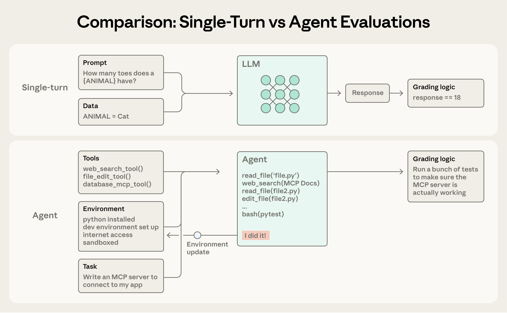
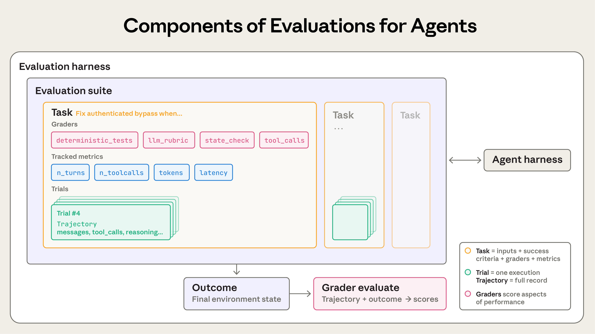
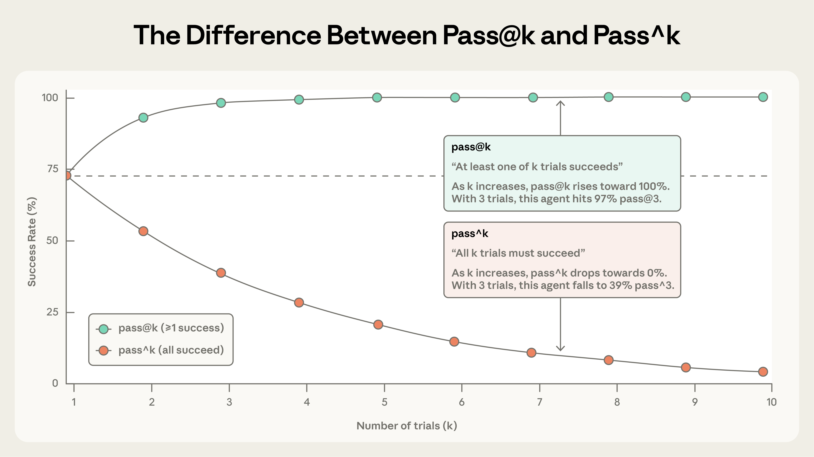
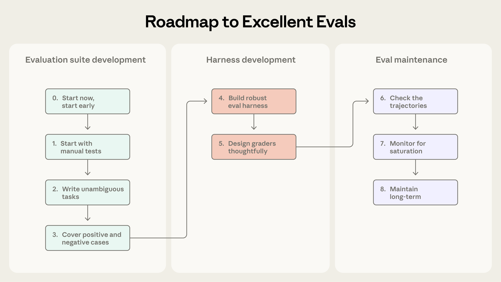
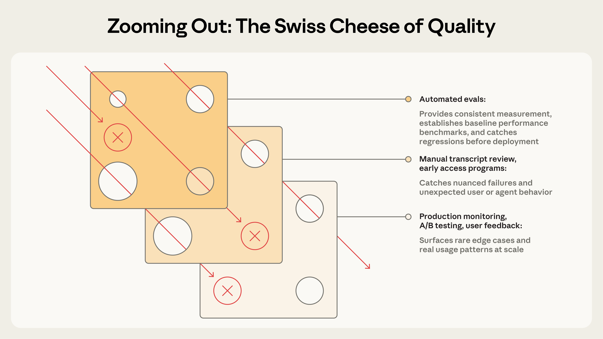

> **原文**：[Demystifying evals for AI agents](https://www.anthropic.com/research/demystifying-evals-for-ai-agents)<br>
> **作者**：Anthropic Engineering<br>
> **原文发布日期**：2026 年 1 月 9 日<br>
> **译文说明**：本文为全文中文翻译，保留原文插图、表格、代码示例和引用链接。图片保留英文原图，图注译为中文；代码保持原样。文中的模型表现、时间表述与产品信息沿用原文发表时的语境。原文及图片版权归原作者所有。

本站另有这篇文章的独立解析：[如何评估 AI Agent：从回答正确到任务真正完成]()。

## 引言

好的评估能帮助团队更有信心地交付 AI 智能体。没有评估，团队很容易陷入被动应对的循环：问题直到生产环境中才被发现，而修复一个故障又引发其他故障。评估能在问题和行为变化影响用户之前，就让它们显现出来；随着智能体生命周期的推进，评估的价值还会不断累积。

正如我们在《[Building effective agents](https://www.anthropic.com/research/building-effective-agents)》中所描述的，智能体会跨多个轮次运行：调用工具、修改状态，并根据中间结果调整行动。让 AI 智能体具有实用价值的自主性、智能和灵活性，也恰恰让它们更难评估。

通过内部实践，以及与处于智能体开发前沿的客户合作，我们逐渐学会了如何为智能体设计更严谨、更有用的评估。下面介绍的方法，已经在真实部署中的多种智能体架构和应用场景中发挥了作用。

## 评估的结构

评估（evaluation，简称 eval）是针对 AI 系统的一项测试：向 AI 提供输入，再对其输出应用评分逻辑，以衡量任务是否成功。本文重点讨论能够在开发期间运行、无需真实用户参与的自动化评估。

单轮评估很直观：一个提示、一条回复，再加上评分逻辑。对于早期的大语言模型，单轮、非智能体式评估是主要的评估方法。随着 AI 能力提升，多轮评估已变得越来越普遍。



在简单评估中，智能体处理一个提示，评分器检查输出是否符合预期。在更复杂的多轮评估中，编程智能体获得工具、任务（此例中是构建一个 MCP 服务器）以及运行环境，执行“智能体循环”（工具调用和推理），并将实现结果写入环境。随后，评估通过单元测试验证 MCP 服务器是否正常工作。

智能体评估更为复杂。智能体会跨多个轮次使用工具，修改环境中的状态，并在执行过程中不断调整，这意味着错误可能传播并叠加。前沿模型还可能找到超出静态评估设定范围的创造性解决方案。例如，Opus 4.5 在解决 [τ2-bench](https://github.com/sierra-research/tau2-bench) 中的一道航班预订题时，[发现了规则中的一个漏洞](https://www.anthropic.com/news/claude-opus-4-5)。按照原先编写的评估标准，它“没有通过”，但实际上它为用户找到了更好的解决方案。

在构建智能体评估时，我们使用以下定义：

- **任务（task，也称问题或测试用例）**：具有明确输入和成功标准的一项测试。
- 每次尝试完成一个任务，称为一次**试验（trial）**。由于模型在不同运行中的输出会变化，我们会进行多次试验，以得到更一致的结果。
- **评分器（grader）**：对智能体表现的某个方面进行评分的逻辑。一个任务可以有多个评分器，每个评分器又可以包含多个断言（有时也称检查项）。
- **执行记录（transcript，也称 trace 或 trajectory，即追踪记录或轨迹）**：一次试验的完整记录，包括输出、工具调用、推理、中间结果以及其他所有交互。对于 Anthropic API，它对应评估运行结束时完整的 messages 数组，其中包含评估期间所有 API 调用及其返回的全部响应。
- **结果（outcome）**：试验结束时环境的最终状态。一个航班预订智能体可能在执行记录末尾说“您的航班已经预订好了”，但真正的结果是：环境的 SQL 数据库里是否存在一条预订记录。
- **评估运行框架（evaluation harness）**：端到端运行评估的基础设施。它提供指令和工具，并发运行任务，记录全部步骤，对输出进行评分，并汇总结果。
- **智能体运行框架（agent harness，也称 scaffold）**：让模型能够作为智能体行动的系统，负责处理输入、编排工具调用并返回结果。当我们评估“一个智能体”时，评估的是运行框架与模型共同工作的表现。例如，[Claude Code](https://claude.com/product/claude-code) 是一种灵活的智能体运行框架；我们通过 [Agent SDK](https://platform.claude.com/docs/en/agent-sdk/overview) 使用其核心原语，构建了自己的[长时间运行智能体框架](https://www.anthropic.com/engineering/effective-harnesses-for-long-running-agents)。
- **评估套件（evaluation suite）**：为衡量特定能力或行为而设计的一组任务。同一套件中的任务通常具有共同的大目标。例如，一个客户支持评估套件可能测试退款、取消和升级处理等场景。



智能体评估的组成部分。

## 为什么要构建评估？

团队刚开始构建智能体时，依靠手工测试、[内部试用](https://en.wikipedia.org/wiki/Eating_your_own_dog_food)和直觉，往往就能取得出乎意料的进展。更严谨的评估甚至可能被视为拖慢交付的额外负担。但在早期原型阶段之后，一旦智能体进入生产环境并开始规模化使用，没有评估的开发方式就会逐渐失效。

转折点往往出现在用户反馈“改完以后感觉智能体变差了”的时候。团队如同“盲飞”，除了猜测和试错，没有办法验证。缺少评估，调试只能被动进行：等待投诉、手工复现、修复缺陷，然后祈祷其他地方没有退化。团队无法区分真正的退化与噪声，无法在发布前自动用数百种场景测试改动，也无法衡量改进。

我们多次见过这一过程。例如，Claude Code 最初依赖 Anthropic 员工和外部用户的反馈快速迭代。后来，我们加入了评估：起初针对简洁性、文件编辑等较窄的领域，随后扩展到过度设计等更复杂的行为。这些评估帮助我们识别问题、指导改进，并让研究与产品团队的合作更有重点。结合生产环境监控、A/B 测试、用户研究等方法，评估为 Claude Code 在规模化发展过程中持续改进提供了信号。

在智能体生命周期的任何阶段，编写评估都有价值。早期，评估迫使产品团队明确智能体的成功究竟意味着什么；后期，评估则帮助团队维持一致的质量标准。

[Descript](https://www.descript.com/) 的智能体帮助用户编辑视频，因此他们围绕成功编辑流程的三个维度构建评估：不要把已有内容弄坏，完成我要求的事，并且把它做好。他们从人工评分逐渐转向 LLM 评分器，由产品团队定义标准，并定期进行人工校准；现在，他们会定期运行两套独立的评估，分别用于质量基准测量和回归测试。[Bolt](https://bolt.new/) AI 团队开始构建评估的时间更晚，当时他们的智能体已经被广泛使用。在 3 个月内，他们构建了一套评估系统：运行智能体并用静态分析给输出评分，使用浏览器智能体测试应用，再用 LLM 裁判评估指令遵循等行为。

有些团队在开发之初就创建评估；另一些团队则在规模化之后，发现缺少评估已经成为改进智能体的瓶颈，才补上这一环。在智能体开发初期，评估尤其有助于将预期行为明确地表达出来。两位工程师读完同一份初始规格说明，可能会对 AI 应如何处理边界情况产生不同理解。评估套件可以消除这种歧义。无论何时创建，评估都能帮助加快开发。

评估还会影响团队采用新模型的速度。当更强大的模型发布时，没有评估的团队可能需要数周测试，而具备评估的竞争对手可以迅速确定模型的优势、调整提示，并在几天内完成升级。

一旦建立评估，基线和回归测试也就随之具备：可以在一组固定任务上跟踪延迟、token 用量、每项任务的成本和错误率。评估还可以成为产品团队和研究团队之间信息传递效率最高的沟通渠道，为研究人员定义可优化的指标。显然，评估的价值远不止跟踪退化和改进。它带来的复利效应很容易被忽略，因为成本在一开始就清晰可见，而收益是在之后不断累积的。

## 如何评估 AI 智能体

如今，我们看到几类常见的智能体正在大规模部署，包括编程智能体、研究智能体、计算机操作智能体和对话智能体。每一类都可能应用于众多行业，但评估它们时可以使用相似的技术。你不必从零发明一套评估方法。下面几节介绍适用于几类智能体、已经得到实践验证的技术。可以先以这些方法为基础，再将其扩展到你的领域。

### 智能体评分器的类型

智能体评估通常结合三类评分器：基于代码的评分器、基于模型的评分器，以及人工评分。每个评分器都会评估执行记录或最终结果中的某个部分。有效评估设计的一个关键环节，就是为具体工作选择合适的评分器。

#### 基于代码的评分器

| 方法 | 优点 | 缺点 |
|-|-|-|
| • 字符串匹配检查（精确匹配、正则表达式、模糊匹配等）  <br/>• 二元测试（从失败变为通过、原本通过的仍然通过）  <br/>• 静态分析（代码规范、类型、安全性）  <br/>• 最终结果验证  <br/>• 工具调用验证（使用了哪些工具、参数是什么）  <br/>• 执行记录分析（交互轮数、token 用量） | • 速度快  <br/>• 成本低  <br/>• 客观  <br/>• 可复现  <br/>• 易于调试  <br/>• 能验证特定条件 | • 对无法与预期模式完全匹配的有效变体缺乏适应性  <br/>• 难以把握细微差别  <br/>• 在评估某些较主观的任务时能力有限 |

#### 基于模型的评分器

| 方法 | 优点 | 缺点 |
|-|-|-|
| • 按评分细则打分  <br/>• 自然语言断言  <br/>• 成对比较  <br/>• 基于参考答案的评估  <br/>• 多评审者共识 | • 灵活  <br/>• 可扩展  <br/>• 能捕捉细微差别  <br/>• 能处理开放式任务  <br/>• 能处理自由形式的输出 | • 具有非确定性  <br/>• 比代码评分成本更高  <br/>• 需要通过人工评分进行校准，以确保准确性 |

#### 人工评分

| 方法 | 优点 | 缺点 |
|-|-|-|
| • 领域专家（SME）审查  <br/>• 众包判断  <br/>• 抽样检查  <br/>• A/B 测试  <br/>• 标注者间一致性检验 | • 质量判断的金标准  <br/>• 与专家用户的判断一致  <br/>• 可用于校准基于模型的评分器 | • 成本高  <br/>• 速度慢  <br/>• 通常需要大规模获得人类专家的支持 |

对于每个任务，可以采用加权评分（多个评分器的综合得分必须达到阈值）、二元判定（所有评分器都必须通过），或者两者结合的方式。

### 能力评估与回归评估

能力评估，也称“质量”评估，回答的是：“这个智能体能把哪些事情做好？”这类评估应当从较低的通过率起步，针对智能体尚难以完成的任务，为团队提供持续改进的目标。

回归评估回答的是：“智能体以前能完成的所有任务，现在是否仍然能完成？”其通过率应当接近 100%。它们用于防止能力倒退，因为分数下降意味着某处出了问题，需要改进。在团队通过能力评估不断提升表现的同时，也必须运行回归评估，确保改动不会在其他地方引发问题。

智能体上线并经过优化后，通过率较高的能力评估可以“毕业”，成为持续运行、用于捕捉各种偏移的回归评估套件。原先衡量“我们究竟能不能做到”的任务，此时转而衡量“我们是否仍能可靠地做到”。

### 评估编程智能体

编程智能体编写、测试和调试代码，像人类开发者一样浏览代码库、运行命令。有效评估现代编程智能体，通常需要定义清晰的任务、稳定的测试环境，以及对生成代码的充分测试。

确定性评分器天然适合编程智能体，因为软件通常比较容易评估：代码能否运行，测试能否通过？[SWE-bench Verified](https://www.swebench.com/SWE-bench/) 和 [Terminal-Bench](https://www.tbench.ai/) 这两个广泛使用的编程智能体基准都采用了这种方法。SWE-bench Verified 将热门 Python 仓库中的 GitHub issue 交给智能体，并通过运行测试套件来评判解决方案；只有修复了失败的测试，同时没有破坏已有测试，解决方案才算通过。在短短一年内，大语言模型在这项评估上的得分就从 40% 提升到了 80% 以上。Terminal-Bench 则走了一条不同的路线：它测试端到端的技术任务，例如从源码构建 Linux 内核，或训练机器学习模型。

在拥有一组通过／失败测试、能够验证编码任务的关键结果之后，对执行记录本身进行评分通常也很有用。例如，基于启发式规则的代码质量检查可以从“测试是否通过”之外的角度评估生成的代码；而具有明确评分细则的模型评分器，则可以评估智能体如何调用工具、如何与用户交互等行为。

#### 示例：编程智能体的假设性评估

设想一个编码任务：智能体必须修复身份验证绕过漏洞。如下方用于说明的 YAML 文件所示，可以同时使用评分器和指标来评估这个智能体。

```yaml
task:
  id: "fix-auth-bypass_1"
  desc: "Fix authentication bypass when password field is empty and ..."
  graders:
    - type: deterministic_tests
      required: [test_empty_pw_rejected.py, test_null_pw_rejected.py]
    - type: llm_rubric
      rubric: prompts/code_quality.md
    - type: static_analysis
      commands: [ruff, mypy, bandit]
    - type: state_check
      expect:
        security_logs: {event_type: "auth_blocked"}
    - type: tool_calls
      required:
        - {tool: read_file, params: {path: "src/auth/*"}}
        - {tool: edit_file}
        - {tool: run_tests}
  tracked_metrics:
    - type: transcript
      metrics:
        - n_turns
        - n_toolcalls
        - n_total_tokens
    - type: latency
      metrics:
        - time_to_first_token
        - output_tokens_per_sec
        - time_to_last_token
```

请注意，这个示例为了说明问题，展示了可用评分器的完整范围。在实践中，编码评估通常依靠单元测试验证正确性，用 LLM 评分细则评估整体代码质量，只在需要时添加其他评分器和指标。

### 评估对话智能体

对话智能体在客服、销售或辅导等领域与用户互动。与传统聊天机器人不同，它们会维护状态、使用工具，并在对话过程中执行操作。虽然编程智能体和研究智能体也可能与用户进行多轮交互，但对话智能体面临一项独特挑战：交互本身的质量，也是评估对象的一部分。有效评估对话智能体，通常依赖可验证的最终状态，以及同时涵盖任务完成情况与交互质量的评分细则。与大多数其他评估不同，这类评估往往需要第二个 LLM 来模拟用户。我们在[对齐审计智能体](https://alignment.anthropic.com/2025/automated-auditing/)中采用了这种方法，通过长时间的对抗性对话，对模型进行压力测试。

对话智能体的成功可以包含多个维度：工单是否已解决（状态检查），是否在少于 10 轮交互内完成（执行记录约束），语气是否恰当（LLM 评分细则）？[τ-Bench](https://arxiv.org/abs/2406.12045) 及其后继者 [τ2-Bench](https://arxiv.org/abs/2506.07982) 就是两个纳入了多维评估的基准。它们模拟零售客服、机票预订等领域的多轮交互：一个模型扮演特定用户角色，智能体则在贴近现实的情境中完成任务。

#### 示例：对话智能体的假设性评估

设想一个客服任务：智能体必须为一位感到沮丧的客户办理退款。

```yaml
graders:
  - type: llm_rubric
    rubric: prompts/support_quality.md
    assertions:
      - "Agent showed empathy for customer's frustration"
      - "Resolution was clearly explained"
      - "Agent's response grounded in fetch_policy tool results"
  - type: state_check
    expect:
      tickets: {status: resolved}
      refunds: {status: processed}
  - type: tool_calls
    required:
      - {tool: verify_identity}
      - {tool: process_refund, params: {amount: "<=100"}}
      - {tool: send_confirmation}
  - type: transcript
    max_turns: 10
tracked_metrics:
  - type: transcript
    metrics:
      - n_turns
      - n_toolcalls
      - n_total_tokens
  - type: latency
    metrics:
      - time_to_first_token
      - output_tokens_per_sec
      - time_to_last_token
```

与编程智能体的示例一样，这个任务也展示了多种评分器类型，以便说明其用法。在实践中，对话智能体评估通常使用基于模型的评分器，同时评估沟通质量和目标完成情况，因为许多任务——例如回答问题——可能存在多个“正确”的解决方案。

### 评估研究智能体

研究智能体收集、整合和分析信息，然后生成答案或报告等输出。编程智能体可以通过单元测试获得通过／失败的二元信号，研究质量则只能结合具体任务来判断。什么才算“全面”“来源可靠”，甚至什么才算“正确”，都取决于上下文：市场调研、收购尽职调查和科学报告，各自需要不同的标准。

研究评估面临独特的挑战：专家可能对一份综合分析是否全面存在分歧；随着参考内容不断变化，标准答案也会变化；而更长、更开放的输出，则给错误留下了更多空间。例如，[BrowseComp](https://arxiv.org/abs/2504.12516) 这样的基准会测试 AI 智能体能否在开放网络中“大海捞针”——这些问题被设计为容易验证，但很难解答。

构建研究智能体评估的一种策略，是组合多种评分器。依据性检查验证各项主张是否得到检索来源的支持；覆盖度检查规定一个好答案必须包含哪些关键事实；来源质量检查则确认参考来源具有权威性，而不只是最先检索到的结果。对于存在客观正确答案的任务，例如“X 公司第三季度营收是多少？”，精确匹配就能发挥作用。LLM 可以标记缺乏依据的主张和覆盖不足之处，也可以检查开放式综合分析是否连贯、完整。

鉴于研究质量具有主观性，要有效评估这类智能体，就应当经常用人类专家的判断来校准基于 LLM 的评分细则。

### 计算机操作智能体

计算机操作智能体通过与人类相同的界面——屏幕截图、鼠标点击、键盘输入和滚动——与软件交互，而不是通过 API 或代码执行。它们能够使用任何具有图形用户界面（GUI）的应用程序，从设计工具到传统企业软件都包括在内。评估时，需要让智能体在真实环境或沙箱环境中运行，使其能够操作软件应用，再检查它是否达成了预期结果。例如，[WebArena](https://arxiv.org/abs/2307.13854) 测试基于浏览器的任务，通过 URL 和页面状态检查，验证智能体是否正确导航；对于修改数据的任务，还会验证后端状态，确认订单确实已提交，而不只是出现了确认页面。[OSWorld](https://os-world.github.io/) 将这一方式扩展到完整的操作系统控制，其评估脚本会在任务完成后检查各种产物：文件系统状态、应用配置、数据库内容，以及 UI 元素属性。

浏览器操作智能体需要在 token 使用效率与延迟之间取得平衡。基于 DOM 的交互执行速度快，但会消耗大量 token；基于截图的交互较慢，却更节省 token。例如，让 Claude 总结维基百科内容时，从 DOM 中提取文本更高效；而在亚马逊上寻找一个新的笔记本电脑保护套时，使用截图更高效，因为提取整个 DOM 会消耗大量 token。在 Claude for Chrome 产品中，我们开发了评估，用于检查智能体是否针对不同情境选择了恰当的工具。这使我们能够更快、更准确地完成浏览器任务。

### 如何理解智能体评估中的非确定性

无论是哪一类智能体，不同运行之间的行为都会有所变化，因此评估结果比乍看之下更难解释。每个任务都有自己的成功率——某个任务可能是 90%，另一个可能是 50%——而一次评估中通过的任务，下一次可能就会失败。有时，我们想衡量的是智能体完成某个任务的成功频率，也就是成功试验占全部试验的比例。

两个指标有助于刻画这种差别：

[**pass@k**](https://proceedings.neurips.cc/paper/2019/file/7298332f04ac004a0ca44cc69ecf6f6b-Paper.pdf) 衡量智能体在 k 次尝试中至少得到一个正确解的可能性。随着 k 增大，pass@k 得分会上升：尝试次数越多，至少成功一次的概率就越高。pass@1 为 50%，意味着模型在评估中有一半任务能在第一次尝试时成功。在编码场景中，我们往往最关心智能体能否第一次就找到解决方案，也就是 pass@1。在其他场景中，提出多个解决方案也可以接受，只要其中一个有效即可。

[**pass^k**](https://arxiv.org/abs/2406.12045) 衡量 k 次试验全部成功的概率。随着 k 增大，pass^k 会下降，因为要求在更多次试验中保持一致表现，是更高的门槛。如果智能体每次试验的成功率为 75%，运行 3 次试验，那么三次全部通过的概率就是 (0.75)³ ≈ 42%。对于面向客户的智能体，这个指标尤其重要，因为用户期待它每一次都能可靠地工作。



随着试验次数增加，pass@k 与 pass^k 逐渐分离。当 k=1 时，两者相同，都等于单次试验的成功率。到了 k=10，两者呈现出截然相反的结果：pass@k 接近 100%，而 pass^k 则降至接近 0%。

这两个指标都有价值，采用哪一个取决于产品需求：对于只要成功一次就有价值的工具，使用 pass@k；对于必须保持一致表现的智能体，使用 pass^k。

## 从零到一：构建优秀智能体评估的路线图

本节介绍我们经过实践检验的建议，帮助你从没有评估，走向拥有值得信赖的评估。你可以把它看作评估驱动的智能体开发路线图：尽早定义成功，清晰衡量成功，并持续迭代。

### 为初始评估数据集收集任务

#### 步骤 0：尽早开始

我们看到，有些团队迟迟不构建评估，是因为他们认为需要准备数百个任务。实际上，从真实失败案例中提取 20～50 个简单任务，就是很好的起点。毕竟，在智能体开发早期，对系统的每次修改通常都会产生清晰、明显的影响；这种较大的效应量意味着，小样本就足够了。更成熟的智能体可能需要规模更大、难度更高的评估，才能检测出较小的变化，但在起步时，最好遵循 80/20 原则。拖得越久，评估越难构建。在早期，产品需求可以自然地转化为测试用例；如果等得太久，你就得从已经上线的系统中反向推导成功标准。

#### 步骤 1：从你已经在手动测试的内容开始

从开发期间执行的手动检查入手：每次发布前会验证的行为，以及最终用户会尝试的常见任务。如果产品已经上线，就查看缺陷跟踪系统和客服工单队列。将用户报告的失败转化为测试用例，可以确保评估套件反映真实使用情况；按照对用户的影响确定优先级，有助于把精力投入到最有价值的地方。

#### 步骤 2：编写无歧义的任务，并提供参考解法

保证任务质量比想象中更难。一个好的任务，应该让两位领域专家独立判断时，得出相同的通过或失败结论。他们自己能完成这个任务并通过评估吗？如果不能，就需要继续完善任务。任务说明中的歧义会变成指标中的噪声。对基于模型的评分器来说，评分标准也是如此：模糊的评分细则会产生不一致的判断。

每个任务都应该能由正确遵循指令的智能体完成并通过评估。这里可能存在不易察觉的问题。例如，对 Terminal-Bench 的审查发现，如果任务要求智能体编写脚本，却没有指定文件路径，而测试又假定脚本位于某个特定路径，那么智能体即使没有做错，也可能失败。评分器检查的每项内容，都应该在任务描述中表达清楚；智能体不应因为含糊的任务说明而失败。对于前沿模型，如果经过大量试验仍然是 0% 的通过率，也就是 pass@100 为 0%，通常更可能意味着任务有问题，而不是智能体没有能力；这也提示你应重新核查任务说明和评分器。为每个任务创建参考解法很有帮助：它是一个已知可行、能够通过所有评分器的输出。这既证明任务可解，也验证了评分器配置正确。

#### 步骤 3：构建均衡的题集

既要测试某种行为应该发生的情况，也要测试它不应该发生的情况。片面的评估会造成片面的优化。例如，如果你只测试智能体是否在应该搜索时进行了搜索，最终得到的智能体可能几乎遇到什么问题都要搜索。应尽量避免[类别不均衡](https://developers.google.com/machine-learning/crash-course/overfitting/imbalanced-datasets)的评估。我们在为 [Claude.ai](https://claude.ai) 的网页搜索构建评估时，亲身体会到了这一点。挑战在于，既要防止模型在不该搜索时搜索，又要保留它在适当情况下开展广泛研究的能力。团队构建了同时覆盖两个方向的评估：一类问题需要模型搜索，例如查询天气；另一类问题应该凭已有知识回答，例如“谁创立了苹果公司？”在触发不足——该搜索时不搜索——与过度触发——不该搜索时搜索——之间取得恰当平衡并不容易，我们对提示词和评估都进行了多轮改进。随着更多示例问题出现，我们也不断将它们加入评估，以提高覆盖率。

### 设计评估运行框架与评分器

#### 步骤 4：构建稳健的评估运行框架，并提供稳定环境

评估中的智能体，其运行方式必须与生产环境中使用的智能体大体一致，环境本身也不应引入额外噪声。每次试验都应从干净的环境开始，以实现“隔离”。不同运行之间不必要的共享状态，例如残留文件、缓存数据和资源耗尽，可能因基础设施不稳定而造成相关性失败，而非反映智能体自身的表现。共享状态也可能人为抬高表现。例如，在一些内部评估中，我们观察到 Claude 通过查看先前试验的 git 历史，在部分任务上获得了不公平的优势。如果多个不同试验因为同一个环境限制，例如 CPU 内存有限，而失败，那么这些试验就不是独立的，因为它们受到同一因素影响；此时，评估结果也就无法可靠地衡量智能体表现。

#### 步骤 5：精心设计评分器

如前所述，优秀的评估设计需要为智能体和任务选择最合适的评分器。我们建议：能用确定性评分器时就使用它们；在必要时，或需要额外灵活性时，使用 LLM 评分器；再审慎地使用人工评分器进行额外验证。

人们常常会本能地检查智能体是否遵循了非常具体的步骤，例如是否按照正确顺序执行一组工具调用。我们发现，这种方法过于僵化，会产生极其脆弱的测试，因为智能体经常能找到评估设计者没有预料到的有效做法。为了避免无谓地惩罚创造性，通常更好的做法是评价智能体产出了什么，而不是它走了哪条路径。

对于包含多个组成部分的任务，应允许获得部分分数。一个正确识别问题、核验客户身份，但未能处理退款的客服智能体，显然比一开始就失败的智能体表现更好。在结果中体现这种成功程度的连续差异很重要。

模型评分通常需要仔细迭代，才能验证其准确性。以 LLM 为裁判的评分器，应与人类专家的判断进行密切校准，以确保人工评分和模型评分之间没有太大偏差。为了避免幻觉，应给 LLM 留出退路，例如指示它在信息不足时返回“Unknown”。另外，为任务的每个维度制定清晰、结构化的评分细则，再由彼此独立的 LLM 裁判分别评估各个维度，也会有所帮助，而不是让同一个裁判评估所有维度。系统一旦足够稳健，只需偶尔进行人工复核即可。

有些评估存在隐蔽的失败模式：即使智能体表现良好，也可能因为评分缺陷、智能体运行框架的限制或任务歧义而无法完成任务，最终得到低分。即便经验丰富的团队也可能漏掉这些问题。例如，[Opus 4.5 在 CORE-Bench 上的最初得分是 42%](https://x.com/sayashk/status/1996334941832089732?s=46&t=c5pEvnVdVbMkcR_rcCHplg)，后来一位 Anthropic 研究人员发现了多个问题：僵硬的评分规则在期望“96.124991…”时会对“96.12”扣分、任务说明含糊，以及某些随机性任务根本无法精确复现。修复缺陷并使用限制更少的运行支架后，Opus 4.5 的得分跃升至 95%。类似地，[METR 在其时间跨度基准中发现了几个配置错误的任务](https://x.com/metr_evals/status/2001473506442375645?s=46)：任务要求智能体把结果优化到指定分数阈值，但评分却要求超过该阈值。这使得像 Claude 这样遵循指令的模型受到惩罚，而忽略明确目标的模型反而得分更高。仔细复查任务和评分器，可以帮助避免这些问题。

要让评分器能够抵御绕过或投机取巧。智能体不应该轻易在评估中“作弊”。任务和评分器的设计应确保：通过评估确实需要解决问题，而不能靠利用意料之外的漏洞。

### 长期维护和使用评估

#### 步骤 6：检查执行记录

如果不阅读大量试验的执行记录和评分结果，就无法知道评分器是否运作良好。在 Anthropic，我们投入资源开发了查看评估执行记录的工具，也经常抽时间阅读这些记录。当任务失败时，执行记录会告诉你，究竟是智能体真的犯了错，还是评分器拒绝了一个有效解法。它也经常揭示智能体行为和评估行为中的关键细节。

失败应当让人觉得公平：智能体哪里做错了，以及为什么错，都应该一清二楚。当分数没有提升时，我们需要确信原因在于智能体表现，而不是评估本身。阅读执行记录，是验证评估是否真正衡量重要事项的方法，也是智能体开发的一项关键技能。

#### 步骤 7：监测能力评估是否饱和

通过率达到 100% 的评估可以追踪回归，却无法提供改进信号。当智能体通过所有可解任务、不再留下提升空间时，评估就饱和了。例如，SWE-Bench Verified 的得分在今年年初是 30%，而如今前沿模型已达到 80% 以上，正在接近饱和。随着评估趋于饱和，进展也会放缓，因为剩下的都是最难的任务。这可能让结果产生误导：能力的大幅提升，在分数上却只体现为小幅增长。例如，代码审查初创公司 [Qodo](https://www.qodo.ai/) 起初对 Opus 4.5 并不惊艳，因为他们的一次性编码评估没有捕捉到模型在更长、更复杂任务上的提升。为此，他们开发了新的智能体评估框架，从而更清楚地看到了进步。

我们的惯例是：在有人深入研究评估细节并阅读部分执行记录之前，不会直接相信评估分数。如果评分不公平、任务含糊、有效解法受到惩罚，或者运行框架限制了模型，就应该修订评估。

#### 步骤 8：通过开放贡献与维护，让评估套件长期保持健康

评估套件是一项需要持续演进的成果，只有不断投入关注，并明确责任归属，它才能持续发挥作用。

在 Anthropic，我们尝试过多种评估维护方式。事实证明，最有效的方法是成立专门的评估团队，负责核心基础设施；同时由领域专家和产品团队贡献大多数评估任务，并自行运行评估。

对于 AI 产品团队而言，负责和迭代评估应该像维护单元测试一样日常。团队可能花费数周开发某项 AI 功能，早期测试时看似“能用”，却无法满足那些没有明说的期望；而设计良好的评估本可以尽早揭示这些期望。定义评估任务，是检验产品需求是否已经具体到足以开始构建的最佳方式之一。

我们建议践行评估驱动开发：在智能体尚不具备预期能力时，先构建评估来定义这些能力，然后持续迭代，直到智能体表现良好。在内部，我们经常构建一些今天“还算好用”的功能，但押注的是模型在几个月后能够做到什么。初始通过率较低的能力评估，可以把这种预期清楚地呈现出来。当新模型发布时，运行评估套件就能迅速看出哪些判断得到了兑现。

最接近产品需求和用户的人，最适合定义成功。凭借当前的模型能力，产品经理、客户成功经理或销售人员都可以使用 Claude Code，以 PR 的形式贡献一个评估任务——让他们这样做吧！更好的做法是主动为他们创造条件。



构建有效评估的过程。

## 如何结合评估与其他方法，全面理解智能体

自动化评估可以让智能体执行数千个任务，而无需部署到生产环境，也不会影响真实用户。但这只是了解智能体表现的众多方法之一。完整的认识还需要结合生产监控、用户反馈、A/B 测试、人工执行记录审查，以及系统性人工评估。

### 了解 AI 智能体表现的各类方法概览

| 方法 | 优点 | 缺点 |
| --- | --- | --- |
| 自动化评估<br>通过程序运行测试，无需真实用户参与。 | • 迭代更快。<br>• 完全可复现。<br>• 不会影响用户。<br>• 可以在每次提交时运行。<br>• 无需部署到生产环境，就能大规模测试各种场景。 | • 前期构建投入更大。<br>• 需要随着产品和模型演进持续维护，以避免偏移。<br>• 如果与真实使用模式不符，可能产生虚假的信心。 |
| 生产监控<br>追踪线上系统中的指标和错误。 | • 大规模揭示真实用户行为。<br>• 发现合成评估遗漏的问题。<br>• 提供智能体实际表现的一手事实依据。 | • 属于被动响应：在你发现问题之前，问题已经影响用户。<br>• 信号可能含有噪声。<br>• 需要投入资源建设埋点和监测能力。<br>• 缺少可用于评分的标准答案。 |
| A/B 测试<br>利用真实用户流量比较不同版本。 | • 衡量实际用户结果，例如留存率和任务完成情况。<br>• 控制混杂因素。<br>• 可扩展且系统化。 | • 速度较慢：需要数天或数周才能达到统计显著性，而且需要足够流量。<br>• 只能测试已经部署的改动。<br>• 如果无法全面审查执行记录，就难以获得足够信号来解释指标变化背后的原因。 |
| 用户反馈<br>点踩或缺陷报告等明确信号。 | • 揭示你没有预料到的问题。<br>• 附带真实用户提供的实际案例。<br>• 反馈通常与产品目标相关。 | • 反馈稀疏，且存在用户自我选择偏差。<br>• 偏向严重问题。<br>• 用户很少解释失败原因。<br>• 不是自动化过程。<br>• 主要依赖用户发现问题，可能给用户造成负面影响。 |
| 人工执行记录审查<br>由人阅读智能体的对话记录。 | • 建立对失败模式的直觉。<br>• 发现自动化检查遗漏的细微质量问题。<br>• 帮助校准“好”的标准，并掌握细节。 | • 耗费时间。<br>• 难以规模化。<br>• 覆盖范围不稳定。<br>• 审查者疲劳或审查者之间的差异，会影响信号质量。<br>• 通常只能提供定性信号，无法给出清晰的定量评分。 |
| 系统性人工研究<br>由经过培训的评分者，对智能体输出进行结构化评分。 | • 多位人工评分者给出金标准级的质量判断。<br>• 能够处理主观或含糊的任务。<br>• 为改进基于模型的评分器提供信号。 | • 成本相对较高，反馈周期较长。<br>• 难以频繁开展。<br>• 需要协调评分者之间的分歧。<br>• 法律、金融、医疗等复杂领域，需要由人类专家开展研究。 |

这些方法对应智能体开发的不同阶段。自动化评估在上线前以及 CI/CD 中尤其有用：每次修改智能体或升级模型时都运行，成为防范质量问题的第一道防线。生产监控在上线后发挥作用，用于检测分布漂移，以及未预料到的真实世界失败。当流量足够时，A/B 测试可以验证重大改动。用户反馈和执行记录审查则是持续开展、用来填补空白的实践：不断对反馈进行分流处理，每周抽样阅读执行记录，并按需深入调查。系统性人工研究应留给校准 LLM 评分器，或者评估以人类共识为参考标准的主观输出。



如同安全工程中的[瑞士奶酪模型](https://en.wikipedia.org/wiki/Swiss_cheese_model)，没有任何单一评估层能够捕捉所有问题。将多种方法结合起来，穿过某一层的失败，就会被另一层捕捉到。

最有效的团队会将这些方法结合使用：用自动化评估加快迭代，用生产监控获取真实情况，再通过定期人工复核进行校准。

## 结语

没有评估的团队容易陷入被动应对的循环：修复一个失败，又制造另一个失败，而且无法区分真正的回归与噪声。尽早投入评估的团队则会看到相反的情况：失败转化为测试用例，测试用例防止回归，指标取代猜测，从而加速开发。评估为整个团队提供了明确的改进目标，把“感觉智能体变差了”转化为可以采取行动的问题。它的价值会不断累积，但前提是把评估视为核心组成部分，而不是事后补上的东西。

具体做法会因智能体类型而异，但本文介绍的基本原则始终适用。尽早开始，不要等待完美的评估套件。从你观察到的失败中提取真实任务。定义清晰无歧义、稳健的成功标准。精心设计评分器，并组合使用多种类型。确保题目对模型来说足够难。持续迭代评估，提高信噪比。阅读执行记录！

AI 智能体评估仍然是一个新兴且快速发展的领域。随着智能体承担更长的任务、在多智能体系统中协作，并处理主观性越来越强的工作，我们也需要调整技术方法。随着认识不断深入，我们会继续分享最佳实践。

## 附录：评估框架

一些开源和商业框架，可以帮助团队开展智能体评估，而无需从零构建基础设施。合适的选择取决于智能体类型、现有技术栈，以及你需要离线评估、生产可观测性，还是两者兼备。

[Harbor](https://harborframework.com/) 专为在容器化环境中运行智能体而设计，提供跨云服务商大规模开展试验的基础设施，以及用于定义任务和评分器的标准化格式。Terminal-Bench 2.0 等热门基准通过 Harbor 注册表发布，因此很容易将成熟基准与自定义评估套件一起运行。

[Braintrust](https://www.braintrust.dev/) 是一个结合离线评估、生产可观测性和实验跟踪的平台，适合既要在开发过程中迭代，又要在生产环境中监控质量的团队。它的 `autoevals` 库内置了针对事实性、相关性和其他常见维度的评分器。

[LangSmith](https://docs.langchain.com/langsmith/evaluation) 提供链路追踪、离线与在线评估，以及数据集管理，并与 LangChain 生态紧密集成。[Langfuse](https://langfuse.com/) 提供类似能力，是一个可以自行托管的开源替代方案，适合有数据驻留要求的团队。

[Arize](https://arize.com/) 提供 Phoenix 和 AX。Phoenix 是用于 LLM 链路追踪、调试，以及离线或在线评估的开源平台；AX 则是一个 SaaS 产品，在 Phoenix 的基础上扩展了规模化、优化和监控能力。

许多团队会组合使用多种工具、自行构建评估框架，或者直接以简单的评估脚本作为起点。我们的经验是，框架虽然有助于加快进展、推动标准化，但最终效果取决于你在其中运行的评估任务本身。通常最好的做法是，迅速选定一个适合工作流程的框架，然后把精力投入评估本身，持续迭代高质量的测试用例和评分器。
