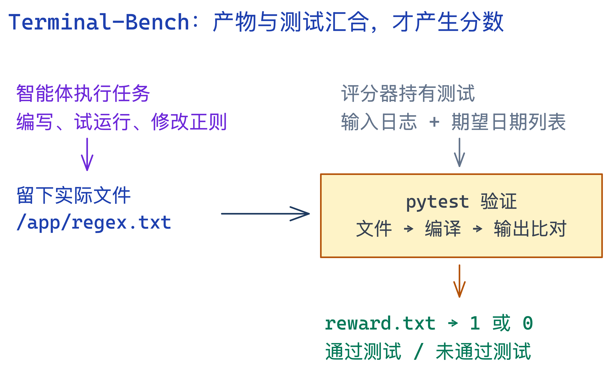

让智能体写一个正则表达式，它给出一段看起来合理的代码，算完成了吗？让客服智能体取消机票，它说“已经为您处理”，又算完成了吗？

这两件事需要的证据完全不同。前者可以运行测试，后者要检查订单是否真的改变，以及这笔订单究竟该不该取消。智能体评估集最有价值的部分，正是把这些证据做成可以重复执行的检查。

此前翻译的 [Demystifying evals for AI agents]() 提到了不少评估集。本文沿着其中的线索，打开真实任务文件，看看一题究竟怎么从用户要求变成一个分数。

> 本文是官方任务、论文和评测代码的案例解析，资料核对于 **2026 年 11 月 5 日**。没有运行付费模型或完整基准，因此不报告模型成绩。文中的操作过程是依据任务重建的教学说明，不是实际运行日志。前文涉及的客服评估集写作 **τ-bench**，τ 是希腊字母 tau；本文讨论的是它及 τ²-bench。

## 先看一张对照表：每个评估集最终验收什么

| 评估集 | 智能体面对什么 | 本文展开的案例 | 主要判分证据 |
| --- | --- | --- | --- |
| Terminal-Bench | 终端、文件系统、程序运行环境 | 为日志提取日期编写正则 | 文件存在、能够编译、测试输出正确 |
| τ-bench / τ²-bench | 用户对话、业务工具、规则及状态 | 航空退订；出国后移动网络故障 | 目标数据库状态，或环境断言 |
| SWE-bench | 仓库、issue、代码工具 | Astropy 嵌套模型的可分离性计算错误 | 指定修复测试和回归测试 |
| WebArena | 可操作的网站环境 | 在论坛创建分区 | 重新打开页面后读取保存的字段 |
| OSWorld | 桌面应用和操作系统 | 打开 Chrome 的 Do Not Track 设置 | 应用持久化配置 |
| BrowseComp | 浏览器或检索工具、复杂事实问题 | 用作者经历等交叉线索定位论文 | 最终答案与参考答案的一致性 |

这张表描述的是本文选中的任务。一个评估集内部也可能有不同评分器，不能把某一道题的检查方式当作所有任务的统一规则。

## 官方 GitHub 地址：代码、任务和环境分别在哪里

这些评估集都有官方公开仓库，但仓库中包含的内容有所不同：有的主要存任务，有的同时提供运行框架和环境部署工具，数据文件或虚拟机镜像也可能通过其他平台下载。

| 评估集 | 官方 GitHub | 主要内容 |
| --- | --- | --- |
| Terminal-Bench 2.0 | [harbor-framework/terminal-bench-2](https://github.com/harbor-framework/terminal-bench-2) | 任务说明、环境配置、参考解和测试 |
| τ-bench | [sierra-research/tau-bench](https://github.com/sierra-research/tau-bench) | 初代航空、零售任务，用户模拟和评测代码 |
| τ²-bench | [sierra-research/tau2-bench](https://github.com/sierra-research/tau2-bench) | 双向操作环境、任务、用户模拟和评分代码；也承载后续版本 |
| SWE-bench | [SWE-bench/SWE-bench](https://github.com/SWE-bench/SWE-bench) | 补丁评测框架及数据集使用入口 |
| WebArena | [web-arena-x/webarena](https://github.com/web-arena-x/webarena) | 网站部署说明、浏览器环境、任务配置和评分器 |
| OSWorld | [xlang-ai/OSWorld](https://github.com/xlang-ai/OSWorld) | 桌面环境接口、任务配置、评分器和运行说明 |
| BrowseComp | [openai/simple-evals](https://github.com/openai/simple-evals) | 综合评测仓库中的 `browsecomp_eval.py` 及数据读取逻辑 |

Terminal-Bench 2.0 使用的运行器另见 [Harbor](https://github.com/harbor-framework/harbor)；本文使用的 SWE-bench Verified 数据另见 [Hugging Face 数据集](https://huggingface.co/datasets/princeton-nlp/SWE-bench_Verified)。BrowseComp 没有放在一个同名的独立官方仓库里。

公开评测资源不意味着所有依赖都免费或随仓库附带。实际运行还需要准备相应的容器、网站或桌面环境，以及被测模型；τ 系列还要配置用户模拟器，模型评分也可能产生调用费用。代码、数据和第三方环境的使用条件应分别查看对应许可证。

## 1. Terminal-Bench：正则写出来了，为什么仍然可能是零分

### 它是什么，主要测什么

[Terminal-Bench 2.0](https://github.com/harbor-framework/terminal-bench-2) 是面向终端智能体的任务基准。它把一项工作放进可运行的容器环境，让智能体通过命令行完成，再检查最终结果。它评估的是从理解要求、使用工具到交付成果的完整过程。

任务范围不限于写代码，还包括环境配置、程序调试、数据处理、安全问题修复等。一个任务通常同时提供说明、环境定义、参考解决方案和验收测试。智能体可以连续执行命令，根据报错调整方案，而不是只提交一道编程题的函数答案。

它适合考察能使用 shell 的开发和运维助手。成绩同时受模型、智能体框架和资源预算影响；终端任务通过率也不能直接代表图形界面操作或客服沟通能力。下面选取 2.0 中的一个小任务，拆开它的交付与验收过程。

### 真实任务：regex-log

`regex-log` 看起来只是要求写一个正则表达式，但它很适合说明“回答正确”和“完成终端任务”的差别。

这道题的要求包含几个容易遗漏的约束：从日志里提取 `YYYY-MM-DD` 日期，但只处理含有合法 IPv4 地址的行；一行有多个日期时，取最后一个；日期和 IP 的前后不能紧贴字母或数字。月份和日期要符合题目定义，二月允许到 29 日，不要求判断闰年；IPv4 的各段不能有前导零。最后必须把正则保存到 **`/app/regex.txt`**。[任务说明](https://github.com/harbor-framework/terminal-bench-2/blob/2fd12b88aafdd04a52c298e3940bcb189f9766d6/regex-log/instruction.md)

下面是按这些规则构造的教学输入，不是原始测试集的复制：

| 输入行 | 应得到的日期 | 原因 |
| --- | --- | --- |
| `2025-01-08 host=192.168.1.7` | `2025-01-08` | 日期可以在 IP 之前 |
| `192.168.1.7 start=2025-01-08 end=2025-02-09` | `2025-02-09` | 必须取该行最后一个日期 |
| `2025-01-08 host=256.1.1.7` | 无 | IP 第一段超出范围 |
| `2025-01-08 host=192.168.01.7` | 无 | IP 含前导零 |
| `job2025-01-08 host=192.168.1.7` | 无 | 日期紧贴字母 |

“能匹配日期”只是一个子问题。智能体还要理解同一行的约束、处理边界，并把结果写到约定位置。

### 一次评测怎么走

运行器先准备任务环境，把任务说明交给智能体。智能体通过终端工具查看文件、编写正则、运行自己的样例，再修改结果。执行结束后，评分器检查留下来的产物。

在这道题里，最终回复中贴出一个完美的正则也不够：如果没有写入指定文件，检查就会失败。


_原创流程图，依据 `regex-log` 的任务和测试文件绘制。图中的分数来自测试结果，不来自智能体的完成声明。_

官方测试先确认文件存在，再读取内容并尝试编译，然后用如下调用提取日期：

```python
re.findall(pattern, log_text, re.MULTILINE)
```

实际匹配结果必须与期望列表一致。因此，返回额外的捕获组、取到第一处日期、跨行误匹配，都会影响结果。这个任务快照的测试数据有 25 行，预期提取出 9 个日期；`test.sh` 根据 pytest 是否通过，把 `1` 或 `0` 写入 `/logs/verifier/reward.txt`。[测试代码](https://github.com/harbor-framework/terminal-bench-2/blob/2fd12b88aafdd04a52c298e3940bcb189f9766d6/regex-log/tests/test_outputs.py)、[评分入口](https://github.com/harbor-framework/terminal-bench-2/blob/2fd12b88aafdd04a52c298e3940bcb189f9766d6/regex-log/tests/test.sh)

这里有三种不同层次的失败：

- **交付失败**：回答得很好，但没有生成文件，或者路径写错。
- **实现失败**：文件存在，但正则语法错误，或返回格式不对。
- **行为失败**：简单输入正确，遇到多个日期、非法 IP 或字符边界就出错。

不过，通过这些测试只能证明通过了这些检查。有限的样例不等于正则在所有可能输入上都正确，测试覆盖范围也是评估质量的一部分。

### Terminal-Bench、Harbor、模型分别负责什么

容易混淆的三个层次是：**Terminal-Bench 提供任务，Harbor 负责组织运行，智能体框架把模型接到终端工具上。** 模型之外，工具设计、上下文管理、超时、重试等都会影响成绩。

如果想理解流程，可以先用官方参考解跑一题。下面是依据 [Harbor 本地任务接口](https://docs.harborframework.com/jobs/run-a-job) 整理的命令示意，本文未执行；需要先安装 Harbor 并准备其环境后端。

```bash
git clone https://github.com/harbor-framework/terminal-bench-2.git
git -C terminal-bench-2 checkout 2fd12b88aafdd04a52c298e3940bcb189f9766d6

# oracle 使用任务提供的参考解，用于检查环境与评分链路。
harbor run -p ./terminal-bench-2/regex-log -a oracle

# 换成实际智能体和模型；模型参数、凭据及依赖需另行配置。
harbor run -p ./terminal-bench-2/regex-log \
  -a terminus-2 -m "<provider/model>"
```

`oracle` 跑通，说明参考解在这套环境里能够通过评分，不能当成某个模型的成功。真正比较模型时，需要固定数据集和框架版本、环境、预算以及重复次数，并保留每次运行的命令轨迹、错误和最终产物。

## 2. τ-bench：用户要求退票，正确结果可能是什么都不改

### 它是什么，主要测什么

[τ-bench](https://arxiv.org/abs/2406.12045) 把评测放进多轮业务对话：一个模型扮演用户，被测智能体扮演客服；客服拥有查询和修改业务数据的工具，还必须遵守领域规则。

初代基准包含航空和零售领域，围绕预订、订单、取消或退换等业务展开。每个任务由用户目标、初始业务数据、工具接口和规则共同构成。用户模拟器掌握自己的诉求，客服则需要通过对话取得信息，并决定哪些操作允许执行。[初代官方仓库](https://github.com/sierra-research/tau-bench)

相比一次性问答，它多了两层难度。用户不会在第一句话里给齐所有条件；用户的要求也不一定符合业务规则。

任务结束后，评测检查业务状态等规定证据，并通过重复试验观察可靠性。它适合研究业务工具使用和规则遵循，但分数也受用户模拟器及评分范围影响，不能直接等同于真实客户满意度。下面的航空案例来自后续 `tau2-bench` 仓库中保留的航空领域，源码版本已固定。

### 航空任务：用户声称“上一位客服已经同意”

在当前仓库的航空任务 `id: 1` 中，用户希望取消一趟从费城到纽约拉瓜迪亚机场的行程。任务给用户模拟器的设定包括：预订超过 24 小时但不到 48 小时，声称之前的客服已经同意退款，而且不接受不退款的取消。[任务文件](https://github.com/sierra-research/tau2-bench/blob/033bf082f48e4a3c6a1256208e93cf2ce9c3bb6f/data/tau2/domains/airline/tasks.json)

从客服的角度，一段合理的处理过程可能是：识别用户，查询预订，核对规则，再解释处理结果。这里的对话过程是教学重建，不是一次实测。

真正有意思的是任务中的判分配置。参考工具调用只查询用户和预订，没有执行取消；任务另有一条自然语言断言，要求智能体不要批准取消。

也就是说，作者期望的目标状态是：**订单不能因为用户坚持要求而被错误取消。**

### 参考动作不是必须照抄的脚本

这类任务通常先在干净环境里执行参考动作，生成目标数据库状态，再将被测智能体运行后的状态与之比较。只要最终状态符合要求，智能体不必逐条复制参考工具调用的顺序。[官方评估说明](https://github.com/sierra-research/tau2-bench/blob/033bf082f48e4a3c6a1256208e93cf2ce9c3bb6f/docs/evaluation.md)

可以把它理解为两个从同一起点出发的分支：

```text
初始业务数据 ── 参考动作 ── 目标状态
      └──── 智能体动作 ── 实际状态
                           ↓
                     比较实际与目标
```

这样设计允许不同的合理解决路径。但它也有边界：最终数据库一样，不代表解释充分、查询过程可靠，或者每句话都遵守了规则。

这道具体任务就展示了这个边界：其 `reward_basis` 是 `DB` 和 `COMMUNICATE`，而 `communicate_info` 为空；上面那条自然语言断言并没有列入最终奖励依据。因而不能仅凭“任务文件写了不要批准”，就断言最终得分完整检查了客服是否口头承诺退款。**要看哪些检查真正参与 reward，而不只是任务描述里有哪些要求。**

这也解释了为什么客服评估不能简单地把“工具调用越多”“修改成功”当成好表现。有时该执行操作，有时该拒绝；而业务状态检查之外，还需要按产品风险补充对承诺、解释和必要流程的检查。

## 3. τ²-bench：后台已经开通漫游，为什么用户还是上不了网

### 它是什么，与 τ-bench 有什么区别

[τ²-bench](https://arxiv.org/abs/2506.07982) 在电信场景中引入了更鲜明的双向操作：客服可以改后台状态，用户也可以通过自己的工具操作设备。评测要求客服通过对话引导用户，共同完成排障。

这里的“用户模拟器”不应只编一句“现在好了”。它对设备的操作会改变模拟环境，环境反馈再约束下一轮对话。

相比初代中主要由客服调用工具的模式，τ²-bench 的核心变化是双方都能行动、却没有相同的操作权限和全部信息。客服知道解决方案还不够，必须把它转化为用户能够执行的步骤。论文还引入组合式任务生成，把故障条件和解决动作组合成可以检验的任务。[τ²-bench 论文](https://arxiv.org/abs/2506.07982)

它更适合考察技术支持中的诊断、沟通和协作：问题可能在后台账户，也可能在设备设置，修复可能需要双方共同操作。不过，用户和设备仍处于模拟环境，不能据此推断真实用户一定理解指引，或真实网络一定以同样方式恢复。

### 真实任务：国外漫游开关没有打开

在电信任务 `user_abroad_roaming_enabled_off` 中，用户正在法国，手机移动网络无法正常使用。初始环境专门设置成：**运营商侧已经启用漫游，但用户设备上的漫游开关关闭。** 用户希望恢复到“excellent”的网络质量，不接受改套餐等不必要的绕路。[任务文件](https://github.com/sierra-research/tau2-bench/blob/033bf082f48e4a3c6a1256208e93cf2ce9c3bb6f/data/tau2/domains/telecom/tasks.json)

可以用下面这条教学流程理解任务：

| 阶段 | 客服要做的事 | 环境中发生的事 |
| --- | --- | --- |
| 了解现象 | 询问所在地、网络症状及设备状态 | 用户反馈受实际状态约束 |
| 区分原因 | 确认后台已开通，继续检查设备设置 | 不能把后台开通等同于手机已启用 |
| 引导操作 | 指导用户打开设备漫游 | 用户侧执行 `toggle_roaming` |
| 验证恢复 | 请用户再次检查网络状态 | 检查连接与速度是否达到目标 |

参考解决动作就是用户侧的 `toggle_roaming`。这不是客服可以随意替用户直接调用的后台接口；它体现了双方工具权限和可操作对象的区别。

### 怎么给分

这道任务的奖励依据是 `ENV_ASSERTION`。配置检查移动数据状态为真，同时检查网速为 `200`、描述为 `excellent`。这些是模拟环境中的断言，不是本文在真实手机上测得的数据。

因此，客服重复开通后台漫游但没有指导用户修改设备，问题仍未解决；客服宣布成功，但环境断言没有通过，也不能算完成。

它测试的不只是“知道漫游开关在哪里”，还包括诊断顺序、信息收集、对用户操作的引导，以及是否验证了结果。

> **版本提醒：** τ-bench、τ²-bench 是论文与基准名称；当前仓库还存在后续版本和新的发布编号。仓库的“2.0”不能直接等同于论文名中的“τ²”。本文链接固定到源码快照，不能把这些任务配置直接套到早期论文的成绩上。

## 4. SWE-bench：补丁看起来对了，还要检查有没有把旧功能修坏

### 它是什么，主要测什么

[SWE-bench](https://www.swebench.com/) 把真实 GitHub issue 和对应仓库交给智能体，让它生成代码补丁。评估重点是补丁在指定测试下是否解决问题，而非与维护者的补丁逐字相同。

与给出完整函数签名的小型编程题相比，智能体需要在已有项目中定位相关代码，理解调用关系和既有行为，再决定修改范围。任务输入包含问题描述和指定版本的代码库，交付物是补丁；评测框架在隔离环境中应用补丁并运行规定测试。[官方仓库](https://github.com/SWE-bench/SWE-bench)

SWE-bench 有不同的数据集版本与子集。本文使用的 **SWE-bench Verified** 是经过人工筛选的 500 个实例，目的是减少问题描述、可解性等因素造成的评测歧义；引用成绩时仍必须写清所用版本。[Verified 数据集](https://huggingface.co/datasets/princeton-nlp/SWE-bench_Verified)

它适合衡量代码维护智能体解决仓库问题的能力，但测试通过并不包办代码风格、架构质量、安全性或全部回归风险。另外，SWE-bench 是评测基准，SWE-agent 等是参与解题的智能体系统，二者不是同一个项目。

### 真实任务：Astropy 的嵌套模型

在 [SWE-bench Verified 数据集](https://huggingface.co/datasets/princeton-nlp/SWE-bench_Verified) 的 `astropy__astropy-12907` 中，问题出在组合模型的可分离性矩阵。

可以把矩阵理解为“每个输出依赖哪些输入”。两个互相独立的一维线性模型，不应该因为外面多嵌套了一层组合，就突然变成彼此依赖。

issue 的关键场景是：先把两个 `Linear1D` 模型组合成 `cm`，再把它与一个 `Pix2Sky_TAN` 模型组合。错误结果把右下角对应两个线性模型的区域全部填成真。

```text
右下角局部矩阵：

错误结果          应有结果
True  True        True  False
True  True        False True
```

参考修复在 `astropy/modeling/separable.py` 的 `_cstack` 中保留右侧子模型已有的依赖矩阵，而不是把对应区域统一写成 `1`。本文是事后解析参考修复；正式测试智能体时，不能把参考补丁和隐藏测试一起当成解题提示。

### 一次评测的验收链

评测工具恢复到指定的基础提交，应用智能体提交的补丁，再应用评测测试并运行。这个实例的数据将测试分为两类：

- **FAIL_TO_PASS**：原先失败、修复后应通过的测试。这个实例列出 2 项。
- **PASS_TO_PASS**：原先通过、修改后仍应通过的测试。这个实例列出 13 项。

第一类检查有没有修复目标问题，第二类检查有没有破坏既有行为。通过率来自规定测试集合；不能自动扩展成“整个仓库所有功能都验证过了”。具体执行由 [SWE-bench evaluation harness](https://www.swebench.com/SWE-bench/guides/evaluation/) 组织。

这里也能看出 SWE-bench 和 Terminal-Bench 的区别：前者以 issue 到代码补丁的任务为核心，后者涵盖更广的终端工作。两者都可能运行测试，但交付对象和环境约束不相同。

## 5. WebArena 与 OSWorld：点击成功，只是过程的一部分

这两个评估集都涉及图形界面操作，但验收不必只依靠截图。

### WebArena：论坛分区到底有没有保存下来

[WebArena](https://github.com/web-arena-x/webarena) 是面向网页智能体的交互环境和任务基准。它提供购物、商城管理、论坛、代码协作等自部署网站，以及地图、百科等辅助资源。智能体接收自然语言目标，通过浏览页面、点击、输入和导航完成工作；任务可能需要查询信息，也可能要求修改网站状态。

它评测的是多步网页工作流，而不只是识别某个按钮。浏览器可以提供无障碍树等观察信息，具体输入和动作接口取决于实验配置，不能把所有 WebArena 成绩都理解成“纯看截图操作”。官方要求复现实验部署自己的环境，并按说明恢复数据状态，避免前一次操作影响后续结果。

WebArena 适合研究浏览器助手的导航、信息整合与表单操作。它的受控网站提高了可重复性，但不能覆盖开放互联网中的全部登录机制、动态改版和异常情况。

本文选取任务 `580`：在论坛网站创建 `sci_fi` 分区，填写指定简介，并在侧边栏加入若干指定栏目。[任务配置](https://github.com/web-arena-x/webarena/blob/dce04686a56253aefba7b18a4fa0937cf1dc987b/config_files/test.raw.json)

智能体需要找到创建入口、填写字段并提交。最终评分器使用 `program_html`：打开该分区的编辑页面，从表单 DOM 读取已保存的简介和侧边栏内容，再检查是否包含要求的文字。

这意味着，下面三个画面虽然都可能看起来“快完成了”，却不能互相替代：

1. 输入框里已经填入内容，但还未保存。
2. 智能体在最终回答里宣布创建成功。
3. 重新进入编辑页面，仍能读到符合要求的内容。

该任务检查的是第三种证据。与此同时，`must_include` 这样的包含检查只约束指定内容，并不等于审查了页面所有细节。

WebArena 的其他任务也可能采用答案字符串、URL 等检查方式。例如查找信息的题目可以直接比较回答；不能把整个基准理解成统一的“截图打分”或“后台数据库打分”。

### OSWorld：开关显示开启，配置是否真正持久化

[OSWorld](https://github.com/xlang-ai/OSWorld) 是在真实桌面软件环境中评估计算机操作智能体的基准。与 WebArena 聚焦网站不同，它把文件、浏览器、办公软件及系统设置等纳入同一操作环境，任务也可以跨应用完成。

每个任务不仅有自然语言说明，还有初始化配置和验收逻辑：先准备文件、打开应用或恢复环境，智能体再根据观察执行鼠标、键盘等动作，最后检查文件内容、应用配置或其他结果。观察方式和允许的动作仍取决于具体实验设置。

它适合考察通用桌面助手能否把视觉理解和操作计划落实为结果。复现需要配置桌面运行后端及相应镜像；软件版本、窗口状态和运行预算都可能影响表现。其成绩不能脱离这些条件，也不能仅用一张“看起来完成了”的截图解释。

在本文选取的 Chrome 任务中，要求是启用 Do Not Track。[任务配置](https://github.com/xlang-ai/OSWorld/blob/8903ebeb0efdf74331bd7dc37ed91ccbbff22317/evaluation_examples/examples/chrome/030eeff7-b492-4218-b312-701ec99ee0cc.json)

评分阶段会执行包括重启 Chrome 在内的收尾动作，然后通过 getter 读取 Chrome 的 Preferences 文件，获取 `enable_do_not_track` 字段，并与期望值 `"true"` 精确比较。[读取配置的实现](https://github.com/xlang-ai/OSWorld/blob/8903ebeb0efdf74331bd7dc37ed91ccbbff22317/desktop_env/evaluators/getters/chrome.py)

智能体操作的是界面，评分器检查的是保存后的应用状态。这个区别很有用：视觉观察负责帮助智能体做事，判分可以使用更直接的环境证据。

这个例子来自基准固定的应用环境，并非当前 Chrome 设置教程；开启该选项也不等于网站必然遵守它。任务验收范围仅是指定配置发生了变化。

## 6. BrowseComp：搜索很多次，最后还是得找到那个短答案

### 它是什么，主要测什么

[BrowseComp](https://openai.com/index/browsecomp/) 收集了 1,266 个难以检索的事实问题。难点往往不是答案很长，而是线索分散，需要跨来源定位、验证和排除候选。

它由 OpenAI 发布，名称来自 Browsing Competition。题目刻意追求“寻找困难、核验相对简单”：答案通常简短、明确且不应随时间改变。智能体获得问题后，使用自己的浏览或检索能力寻找证据，再提交答案。公开评测入口位于 [simple-evals 仓库](https://github.com/openai/simple-evals/blob/main/browsecomp_eval.py)，它本身不是一套完整的浏览器智能体。

与 WebArena 的填表、创建条目等任务不同，BrowseComp 的主要交付物是事实答案，重点是困难信息的发现与整合。它适合衡量研究助手的检索能力，但没有把长报告的结构、论证充分性与引用质量一并变成完整的验收标准。

### 官方公开的构题示例：通过作者经历定位论文

官方介绍给出过这样一种问题构造：寻找指定年份区间内的 EMNLP 论文，同时限定第一作者和第四作者各自的本科院校。示例指向 *Frequency Effects on Syntactic Rule Learning in Transformers*。

这是官方用来说明题目如何构造的公开例子，本文不把它说成已运行的一条正式测试记录。

它要求把不同来源的证据连接起来：论文集提供会议、年份和作者顺序；作者主页或履历提供教育背景；两者必须对应到同一篇论文和同一批人。

一个合理的教学求解过程是：先缩小论文范围，再验证作者顺序和经历，排除同名作者及不满足年份的候选，最后给出论文标题。不能仅因为搜索结果里出现了某个大学名，就把候选当成答案。

### 判分重点是答案，不是搜索动作数量

BrowseComp 的设计使用模型评分器比较最终答案和参考答案，允许一定的语义等价表达。其 [公开评测代码](https://github.com/openai/simple-evals/blob/main/browsecomp_eval.py) 展示了答案提取和比较提示词；实际复现还需要验证所用版本的解析与计分实现。

因此，打开几十个网页不等于得分更高；给出一篇很长的综述，也未必答对要找的那个事实。另一方面，最终答案正确，不能单独证明每条引用都可靠、每一步推理都有效。

如果要评估研究助手的长报告质量，还应另外检查引用是否支持论断、证据覆盖范围、遗漏和冲突处理。BrowseComp 的事实检索成绩无法包办这些要求。

## 7. 怎样把这些评估集用到自己的智能体上

最有效的起点通常是选一题，把评分过程看明白，再扩大规模。

**第一步，按交付物选任务。** 智能体主要修代码，就从 SWE-bench 类任务入手；主要在终端处理文件和环境，可以看 Terminal-Bench；主要处理业务对话，则应学习 τ-bench 的政策、用户模拟与状态检查。跨网站和桌面的操作分别参考 WebArena、OSWorld，困难事实检索参考 BrowseComp。这是任务匹配，不是把六个榜单分数相加。

**第二步，同时打开说明、环境和评分器。** 以 `regex-log` 为例，只读任务说明会漏掉测试实际如何调用正则；以航空任务为例，只读参考动作会误以为必须按顺序调用工具，只读自然语言断言又可能误判最终奖励覆盖了什么。

**第三步，先检查评测链路。** 有参考解的任务先跑参考解；再用一个故意错误的产物确认评分器确实会失败。错误路径、环境起不来、解析器读错结果，都可能让最终分数失真。模型没完成任务与评测基础设施失败，应分别记录。

**第四步，固定比较条件并重复运行。** 至少保存下面这些信息：

| 项目 | 为什么要保存 |
| --- | --- |
| 数据集版本、任务 ID、环境镜像 | 确认两次面对的是同一道题和同一环境 |
| 模型版本、智能体框架和提示词 | 区分模型变化与系统变化 |
| 时间、token、工具调用预算 | 避免用不同资源条件比较成绩 |
| 重复次数、随机性、重试规则 | 区分偶尔成功与稳定完成 |
| 每次轨迹、产物和评分器输出 | 让失败可以定位，而不只剩一个百分比 |

最后要看清指标的含义：**pass@k** 关心多次尝试中至少成功一次，**pass^k** 关心多次尝试是否全部成功，**pass@1** 则描述单次尝试的成功情况。采用具体统计估计时，还应遵循对应基准的采样和计算方式。

假设某个任务每次独立成功的概率为 80%，重复 3 次：至少成功一次的概率是 `1 - (1 - 0.8)^3 = 99.2%`，全部成功的概率是 `0.8^3 = 51.2%`。这只是独立、同分布假设下的教学计算，不是任何模型的实测成绩。

对于可以反复尝试再筛选补丁的开发流程，“至少一次成功”有价值；对于直接办理订单的客服，“每次都可靠”往往更重要。

读这些评估集，最值得带回自己项目的不是排行榜名次，而是具体的验收方式：文件有没有生成，补丁有没有通过测试，订单是否处于正确状态，用户设备有没有恢复，网页字段是否真正保存，最终事实能否被核实。先把“完成”变成可以检查的证据，模型分数才有可解释的含义。
