> **原文**：[The components of agent memory](https://www.anthropic.com/research/components-of-agent-memory) 
> **作者**：Lance Martin（Anthropic Engineering） 
> **原文发布日期**：2026 年 11 月 6 日 
> **原文主题**：智能体、上下文工程、智能体记忆 
> **译文说明**：本文为全文中文翻译，保留原文结构、实验数据、引语、全部插图及正文引用链接。图片保留英文原图，替代文本和图注译为中文。Dreaming 首次出现时译为“做梦（后台记忆整理）”，后文保留英文术语。文中的“我们”指原作者团队，模型名称、产品信息、实验结论和相对时间均沿用原文发表时的语境。原文及图片版权归原作者所有。

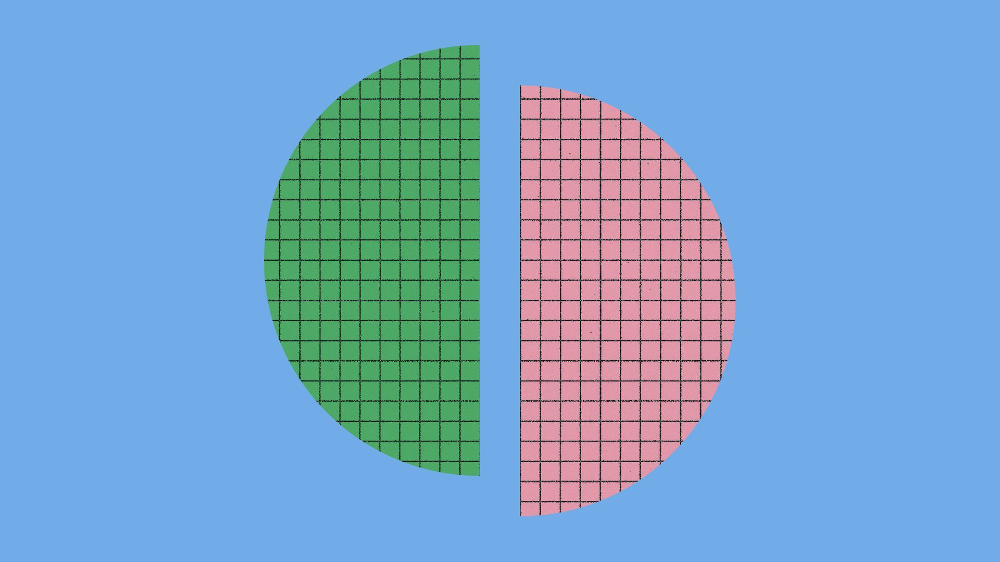

## 引言

索伦·克尔凯郭尔曾写道：人生只能向后看才能理解，却必须向前走才能度过。为 AI 智能体设计记忆时，我们也遇到了类似的困境。

人类在日常生活中不断编码记忆。[海马体](https://stanford.edu/~jlmcc/papers/McCMcNaughtonOReilly95.pdf)在其中起着核心作用：它即时捕捉经历，使记忆迅速形成并可立即调用。但只有[一部分经历](https://www.science.org/doi/10.1126/science.adk8261?referrer=https%3A%2F%2Fwww.google.com%2F)会被巩固为长期知识。

这种巩固似乎有很大一部分发生在大脑“离线”的时候。在睡眠和[安静休息](https://www.nature.com/articles/s41467-018-06213-1)期间，海马体会重放我们近期的经历。人们认为，这个过程会逐步[提炼这些经历，并将其整合到新皮层中](https://www.nature.com/articles/s41593-019-0467-3)；我们通常所说的知识，大多就储存在这部分大脑里。

智能体记忆也可以采用类似的分工。智能体会把大量工作记录在日志或执行记录中。Letta 和加州大学伯克利分校的研究人员提出了[“睡眠时间计算”（sleep-time compute）](https://arxiv.org/abs/2504.13171)：让模型利用交互间隙的空闲时间，重新组织已有上下文。同样的思路也能帮助智能体组织记忆：回顾日志，修正错误，或者生成新的笔记和表示形式。这个过程通常被[称为](https://platform.claude.com/docs/en/managed-agents/dreams)“[做梦（dreaming）](https://research.google/blog/the-sleep-framework-a-new-way-for-llms-to-retain-knowledge-in-continual-learning/)”（即后台记忆整理，见图 1）。

我们发现，在帮助 Claude 获得有效记忆的过程中，dreaming 是一种很有用的工具。本文将分享我们对智能体记忆逐渐形成的理解，并介绍几项用于探索智能体记忆的评估，包括对 dreaming 的评估，以及各个组件分别如何帮助组织记忆。

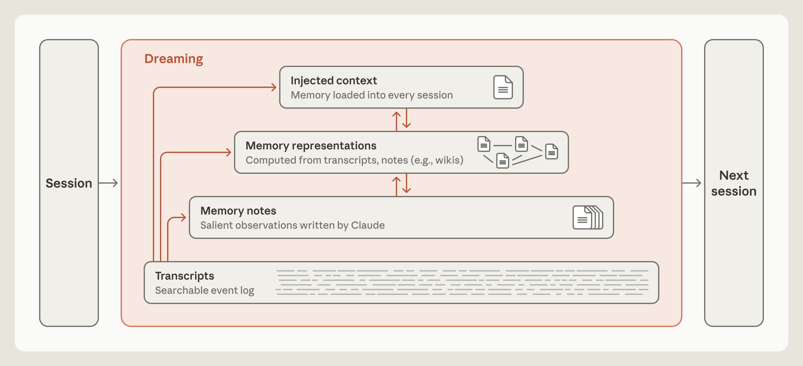

*图 1：Claude 可以通过 dreaming 组织记忆。这可以修正错误、创建笔记、构建新的记忆表示形式，或者调整未来会话中预先加载的内容。*

## 记忆笔记

我们所说的“智能体记忆”，是指 Claude 从经历中获得的知识，包括与用户的交互，以及被分配的任务；这些知识会在会话之间保留下来，保存为以后可以读取的上下文。它不包括模型学习或管理上下文的其他方式，例如修改权重（训练期间设定的内部参数）、[上下文学习](https://www.anthropic.com/research/in-context-learning-and-induction-heads)（在单次对话中获得知识），以及[上下文压缩](https://platform.claude.com/docs/en/build-with-claude/compaction)（compaction：由 Claude 编写摘要，替换较早的对话轮次，使其能在新的上下文窗口中继续工作）。

在人脑中，一次经历之前、期间或之后释放的化学信号，可以[把某段记忆标记为重要](https://www.nature.com/articles/385533a0)。在离线期间，被标记的记忆往往比未被标记的记忆重放得更频繁。这个被称为“重放”的过程，有助于稳定记忆，并将其整合到长期记忆中。

类似地，Claude 可以在重要事件发生时，将其标记在会话日志中，以便以后更容易找到；也可以把它们[写入记忆存储](https://platform.claude.com/docs/en/agents-and-tools/tool-use/memory-tool)，例如一个存放记忆笔记的文件夹（见图 2）。但在尚不知道接下来会发生什么的情况下，Claude 怎么判断眼前哪些信息值得记住呢？

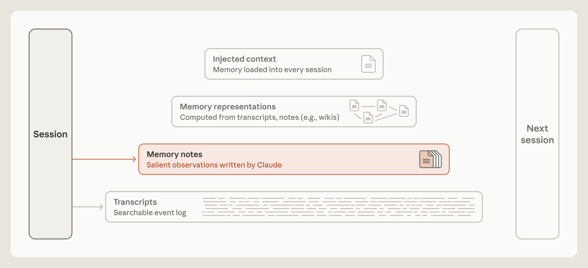

*图 2：Claude 可以把笔记写入记忆。*

### 记忆可以是对未来需求的预测

有时，记忆是一种预测。智能体写下一条规则，就是在预测：这条规则描述的模式以后还会有用。例如，写下一条已核实的事实，就是在预测：未来某次会话中的智能体，会希望直接依赖这条事实，而无需再次核查。随着时间推移，Claude 越来越擅长做出这类预测。

来看[持续学习基准 Continual Learning Bench（CL-Bench）1.0](https://continual-learning-bench.com/news/cl-bench-1-0/) 中的一项任务。这个基准衡量智能体利用记忆处理长程任务的能力。其中一项任务要求 Claude 查询数据库中的信息，回答一系列问题。Claude 给出答案后，会收到正确答案，并可以写下一条记忆，帮助回答未来的问题。

记忆在这里可以支撑一个学习闭环。如果 Claude 答错了，它可以记录失败，提出关于错误原因的假设，检验这些假设，再把发现转化为以后回答问题时遵循的规则。

我们使用 [Claude Managed Agents](https://platform.claude.com/docs/en/managed-agents/overview) 运行了这项 CL-Bench 1.0 任务。每道题都从一个全新的会话开始，唯一的例外是：Claude 可以读取一个[记忆目录](https://platform.claude.com/docs/en/managed-agents/memory)中的文件，而该目录会在不同会话之间保留。

不同模型在建立自己的学习闭环方面，取得的进展并不相同。Claude Sonnet 4.6 做到了针对错误答案提出假设。它的记忆目录中散落着一些文件，每个文件都列出了若干未经检验的猜测。

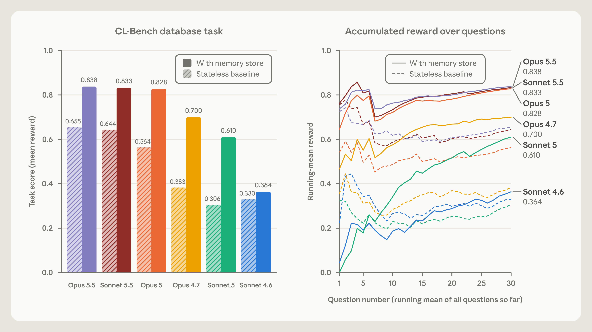

*图 3：在 CL-Bench 数据库任务中，对比不同模型使用记忆与无状态基线的表现。*

| 模型 | 无状态基线的平均奖励 | 使用记忆存储的平均奖励 |
| --- | ---: | ---: |
| Opus 5.5 | 0.655 | 0.838 |
| Sonnet 5.5 | 0.644 | 0.833 |
| Opus 5 | 0.564 | 0.828 |
| Opus 4.7 | 0.383 | 0.700 |
| Sonnet 5 | 0.306 | 0.610 |
| Sonnet 4.6 | 0.330 | 0.364 |

Claude Opus 4.7 将笔记整合成了一份参考文档，并开始标注哪些事实已经核实，哪些仍未确认。Claude Sonnet 5 会在评分器检查后，将每个答案标记为已确认；如果先前答错了，就写下更正。

Claude Opus 5 是这些模型中第一个真正完成学习闭环的。它的大部分条目都包含一条规则，以及它如何知道这条规则是正确的；还包含之前问题的答案，以及对过程中发现的陷阱的明确警告（见图 3）。

与 Opus 5 一样，Claude Opus 5.5 和 Claude Sonnet 5.5 也都完成了这个闭环，利用记忆保存经过验证的规则，以更好地回答未来的问题。使用记忆后，两者的分数都与 Opus 5 大致相同，不过在不使用记忆的基线测试中，它们的表现略高一些。

### Claude 已经学会判断什么值得记住

我们还评估了 Claude 玩《宝可梦 红》的能力。这个游戏[要求 Claude 应对复杂的长程任务](https://www.youtube.com/watch?v=CXhYDOvgpuU)，因此我们用它来检验 Claude 对“哪些内容应该存入记忆”的判断。每次运行开始时，我们都会给模型一个记忆文件夹，让它在游戏过程中读取和写入文件（见图 4）。

我们分别选取 Claude Sonnet 3.7 和 Claude Fable 5 的一次运行，在两者都进行到大约 10,000 步时，对比其记忆文件夹。一个显著差异在于：两个模型对“什么值得记住”的判断不同。Sonnet 3.7 认为任何事情都可能重要，于是不加区分地写入记忆。它的记忆文件夹是一份遭遇事件档案，通常每场战斗、每件找到的物品、每个遇到的非玩家角色，都各有一份单独的文件。最终，Sonnet 3.7 在 225 个文件夹中写下了 413 个记忆文件，并获得了一枚徽章；徽章用于标记玩家在游戏中的进度。

相比之下，Fable 5 在两个文件夹中写下了九个文件，外加一个名为 `global.md` 的顶层文件，并获得了四枚徽章。

*图 4：Sonnet 3.7 与 Fable 5 玩宝可梦时的记忆目录对比。*

Sonnet 3.7 的做法之所以成为问题，主要是因为宝可梦的游戏状态不断变化，它留下的详细记录也不断过时。因此，随着游戏推进，Claude 必须花费越来越多的时间和资源梳理记忆，而不是玩游戏。例如，在第 10,000 步左右，Sonnet 3.7 开始建立第四个存放“主”记忆文件的文件夹。接下来的 17 步中，它创建了六个文件，删除了另外九个文件，却没有在游戏中执行任何行动。

Fable 5 则用记忆保存游戏没有明确告诉它的事情。Sonnet 3.7 写入记忆的某些信息，例如玩家有多少钱、位于地图上的什么位置，每个回合都能直接从屏幕上看到，因此存下来是重复劳动。相比之下，关于策略、计划和经过检验的规则的记忆文件，只有 Claude 自己推导出来才会存在；如果不写下来，这些内容就会消失。

Fable 5 据此组织自己的记忆。它的 `global.md` 文件充当仪表盘，保存当前目标、预先写好的道馆挑战计划，以及模型自己制定的记忆使用规则；道馆是赢取徽章的挑战场所。`locations` 文件夹保存特定路线的行进计划，`gameplay` 文件夹则保存基于它对游戏机制的认识而形成的策略。例如，在连续七个精灵球都没能捕捉到鲤鱼王——最容易捕捉的宝可梦之一——之后，Claude 写道：“如果连续 3 个以上的球都失败，就改变操作时机（在菜单操作步骤之间额外插入‘等待’按键）——这样做之后，紧接着就捕捉成功了。”

凭借小得多的记忆文件夹，Fable 5 在游戏中比 Sonnet 3.7 推进得远得多。Opus 5.5 采取了类似做法：维护一个小型记忆笔记文件夹，跟踪当前目标和下一步行动，并在游戏过程中不断重写这些笔记，最终通关。

### 引导 Claude 写入记忆

我们发现，告诉 Claude 记忆是用来做什么的很有帮助，但不必规定它具体应该如何使用。在 CL-Bench 上，我们只是告诉 Claude：有一个记忆文件夹可供使用。这种一般性指导，就足以让 Opus 4.7 和 Opus 5 有效使用记忆，并使两者的表现都得到明显提升（见图 3）。

我们还测试了为模型制定具体规则，告诉它们应该把什么写入记忆；每次测试使用一条规则。我们对比了每个模型在遵循规则时从记忆中获得的增益，以及没有这条规则时获得的增益。当规则是“只记录失败”时，Opus 5 和 Opus 4.7 都损失了记忆原本带来的大部分性能提升（见图 5 右）。对于能力较强的模型，让它们自由判断什么值得记住，比事先设定固定规则更有效；这些规则最终反而可能削弱表现。

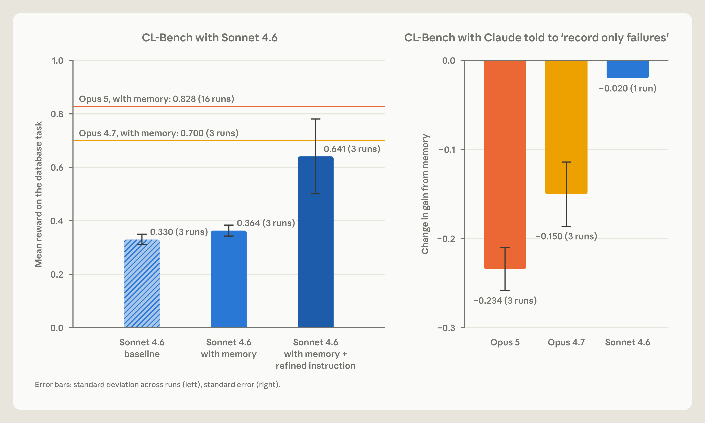

*图 5：左：Sonnet 4.6 在 CL-Bench 数据库任务中，有无记忆使用指导提示时的表现。右：要求只记录失败后，各模型从记忆中获得的增益变化。*

我们还注意到，这种引导对较旧的模型帮助最大。例如，Sonnet 4.6 经常不读取记忆目录中的文件，也不会检验自己对错误原因提出的假设。

在这种情况下，提示 Claude 在回答前先读取记忆文件，再明确检验自己的假设，几乎使其基准得分翻倍（见图 5 左）。Sonnet 5 则会主动这样做：即使没有收到相应提示，十次回答中也有九次会先读取记忆。相比之下，Sonnet 4.6 这样做的比例不到一半。

对于前沿 Claude 模型，我们通常只提供简单指导：当用户要求记住某件事，或者某件事显然值得记住时，就创建记忆笔记；具体判断交给 Claude。

## Dreaming 可以纠正记忆

Claude 根据自己在会话中对信息重要性的判断写入记忆，因此，一条从一开始就写错了的笔记，或者一条随环境变化而失准的笔记，都可能在后续会话中被 Claude 读取并信任。

Dreaming 为 Claude 提供了一种对照原始执行记录检验笔记的方法（见图 6）。当 Claude 使用 Managed Agents 玩宝可梦，并把记忆放在一个挂载目录中时，我们观察到了一个正面例子。

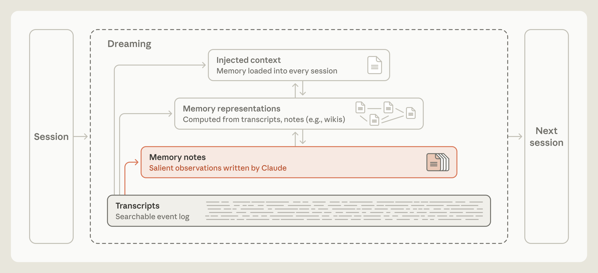

*图 6：Dreaming 可以纠正记忆中的错误。*

在游戏的一处关卡中，玩家必须穿过月见山。它是一套洞穴系统，入口位于地图西侧，出口位于东侧。入口附近有一个陷阱：一道只能单向跳下的台阶，会把玩家送回之前来时的道路，而且看不出有办法爬回去。Claude 把山口处的宝可梦中心当作地标，因此，它会不会走下台阶，取决于它认为宝可梦中心位于山的哪一侧。

在某个时刻，Claude 错误地记下：宝可梦中心位于东侧。当它走出宝可梦中心时，它宣称“月见山已经在我身后了”，并更新笔记：“月见山已完成。”但它其实并没有穿过月见山。几次操作之后，Claude 跳下台阶，回到了来时的道路（见图 7）。导航工具没有显示这次落差，于是 Claude 得出结论：“我向西走过头了”，并认为自己之前一直处在正确的一侧。事实并非如此。

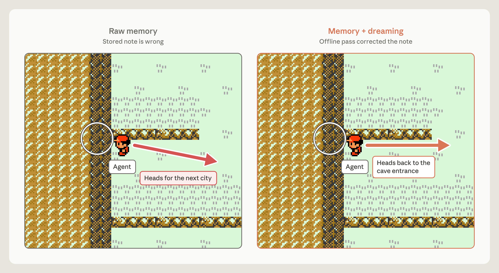

*图 7：一条经过纠正的记忆笔记改变了宝可梦中的结果。使用未经纠正的笔记时，Claude 说“月见山已经在我身后了”，随后前往下一座城市，最终却回到来时的道路。笔记经 dreaming 纠正后，它说“现在我需要找到月见山的洞穴入口，重新进去”，然后返回洞穴。*

随后，我们测试了 dreaming 能否帮助 Claude 避开这个陷阱。我们对那个错误记录了宝可梦中心位置的记忆文件夹运行了 dreaming：Claude 将笔记与会话执行记录进行核对，发现错误，并重写了笔记。执行记录提供了可用于验证记忆的事实依据。使用纠正后的记忆笔记，Claude 直接返回月见山，最终到达华蓝市。

在使用未经纠正笔记的运行中，Claude 三次掉回先前的道路。第三次失败后，Claude 似乎打算放弃，写道：“我准备停下来，不再继续兜圈子了。”我们实验设置中的自动回复要求它继续，于是它又一路回到山前的城镇——深灰市，希望在那里恢复状态并补充物资。这次运行结束时，Claude 始终没能到达华蓝市。

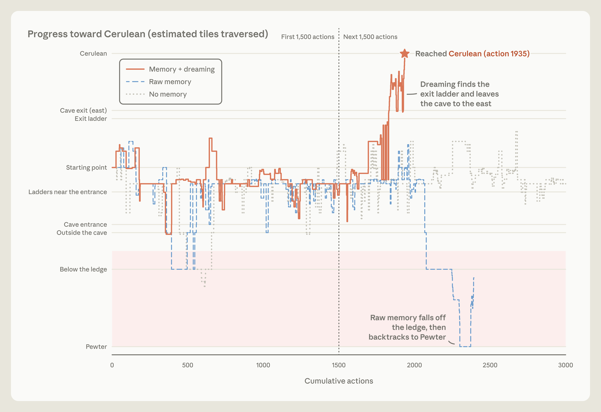

*图 8：Dreaming 纠正了记忆，Claude 返回洞穴并到达下一座城市。使用未经纠正笔记的运行（“原始记忆”）始终没能越过这座山，没有记忆的运行也是如此。*

## Dreaming 可以构建新的记忆表示形式

借助 dreaming，Claude 可以构建帮助自己浏览记忆的表示形式（见图 9）。其中一种称为 [Wiki](https://gist.github.com/karpathy/442a6bf555914893e9891c11519de94f)：由 Claude 编写和维护的一组页面，将它对某一主题的知识汇集起来，并链接到其他笔记。这些链接实际上为 Claude 提供了一张地图，使它能够筛选记忆，在需要时高效地找到相关内容。

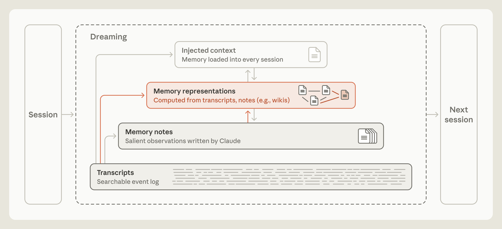

*图 9：Dreaming 可以构建记忆表示形式。*

Wiki 这样的表示形式，可以帮助 Claude 遍历不断增长的知识库。我们使用 Stainless 的内部文档语料，探索了 Wiki 作为记忆表示形式的价值。Stainless 是我们在 5 月收购的一家软件公司，这批语料大约有 350,000 个文件，约 4.2 亿个 token。我们围绕这些语料创建了一组包含 25 个问题的评估，并为 Claude 提供搜索工具来探索它们。我们还要求 Claude 通过 dreaming，以这些文件为基础构建 Wiki。在 128 次会话中，我们提示 Opus 5 智能体探索文件，编写或修正相互链接的 Wiki 页面，合并重复内容，并对照来源核实其中的陈述。

每次会话都接续此前智能体的进展，并通过共享日志协调工作。当 dreaming 从两次会话扩展到 128 次时，模型在这 25 个问题上满足评分标准的比例，从 13% 提升到了 48%（见图 10）。

Claude 以增量方式构建 Wiki。创建初始 Wiki 后，它会在后续的 dreaming 轮次中添加、编辑或删减内容。在早期的 dreaming 轮次中，Claude 的知识水平像一名新员工，仅依靠 Wiki 回答问题的能力还很有限。Dreaming 进行得越多，它的知识地图就越丰富，逐渐像一名经验丰富的员工。在测试中，我们发现，当同时提供搜索工具时，Wiki 对 Claude 的帮助最大。随着 Wiki 不断丰富，同时使用搜索和 Wiki 时，Claude 的综合得分从 54% 升至 61%；仅使用搜索工具时为 53%。仅用 Wiki 回答问题时，Claude 的最高得分为 48%。结合使用搜索和 Wiki，还使每个问题节省了大约 20,000 个 token。

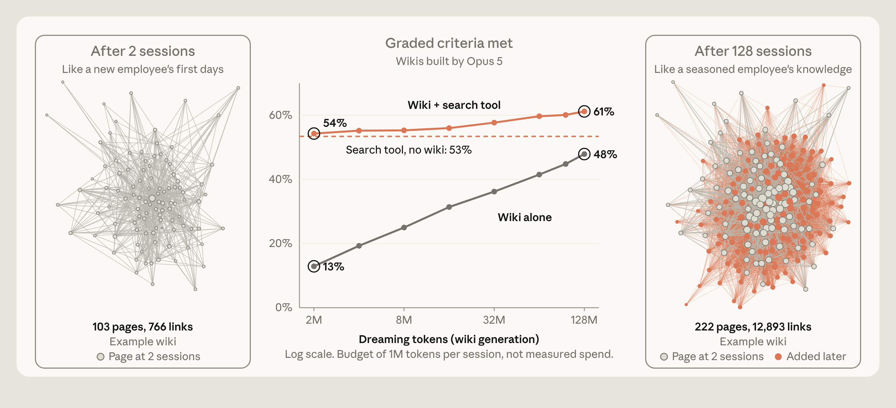

*图 10：中：Claude 在连续会话中构建 Wiki 时，对某公司文档语料的 25 个问题的得分。左、右：两次和 128 次会话后的示例 Wiki；每个点代表一个页面，线条连接相互链接的页面。*

我们希望测试，哪些类型的任务能从 Wiki 中受益。为此，我们使用了 [Harvey LAB](https://github.com/harveyai/harvey-labs) 基准，以及一组关于企业合并的文档。该基准给 Claude 一组文档，要求它根据文档内容生成一份法律简报，然后按照一组标准对简报评分。虽然这些评估可能不如玩宝可梦那么有趣，但它们为构建 Wiki 提供了多样化的文档集合。

我们要求 Claude 依据文档构建 Wiki，然后分别利用 Wiki 和直接文件搜索，回答问题（关于企业合并）或生成法律简报（LAB 基准）。一项测试包含 24 个关于企业合并的问题（见图 11 左），其中超过一半要求 Claude 从多份文档中查找信息，许多问题还需要它作出判断或进行计算。在这些题目上（红色和橙色连线），Claude 查阅 Wiki 时的得分为 87%，仅使用搜索时为 73%。

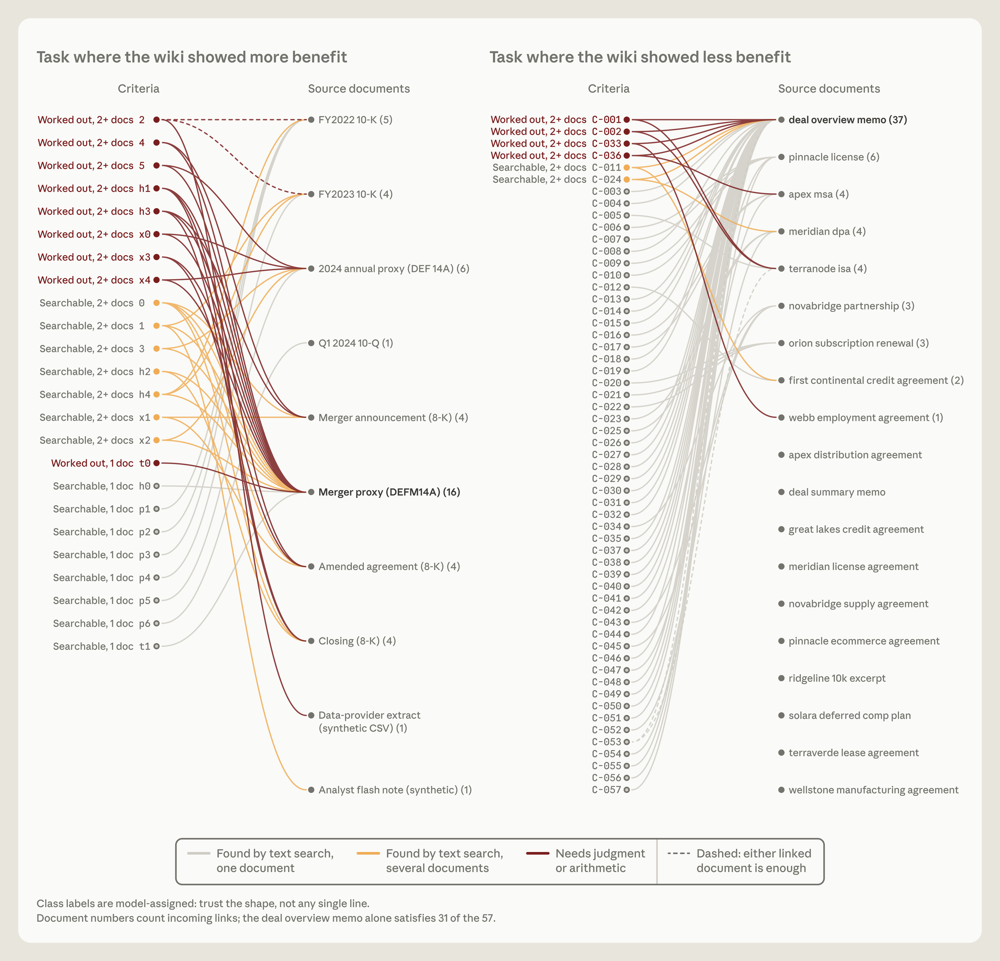

*图 11：每幅图的左侧列出评分内容，右侧列出满足相应标准所需的源文档。左：24 个关于企业合并的问题，主要可以通过公开披露文件回答；超过一半的标准需要整合多份文档的信息。右：一项 Wiki 未带来明确增益的 LAB 任务，大多数标准都能通过单份文档满足。*

在其他情况下，Wiki 的作用较小。在一项 LAB 任务中（见图 11 右），简报评分标准所需的信息，往往可以从单份文档中通过文本搜索找到，相比搜索，Wiki 没有带来明确的性能提升。在另一项 LAB 任务中，Wiki 甚至比文档本身还大（见图 12）。这就像博尔赫斯那篇只有一个段落的短篇小说《论科学的精确性》中的制图师：他们绘制的地图如此详细，以至于与所描绘的帝国一样大。Claude 制作了一份极其详细的 Wiki，却实际上没有完成任何抽象。

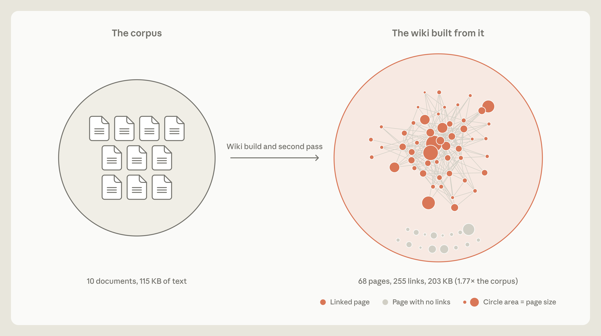

*图 12：Wiki 的体积超过了原始文件。*

## Dreaming 可以将笔记提升到记忆层级的顶部

Dreaming 还可以把笔记提升到记忆层级的顶部，再由智能体运行框架（agent harness）在每次会话开始时，预先加载到 Claude 的上下文中（见图 13）。这意味着 Claude 不必搜索它们，甚至不必事先知道有什么需要搜索。

将记忆带入新会话，是上下文注入的一种形式，必须谨慎进行。注入的记忆会占用宝贵的 token，而一条错误笔记可能被带入每次会话。加载一条笔记，也不能保证 Claude 会照着做：我们的 [Claude Code 文档](https://code.claude.com/docs/en/memory)提醒，指令文件越长，遵循程度就越低。因此，记忆层级的顶层必须保持相对精简；dreaming 在这里的很大一部分工作，就是把一些细节下移到更低层，并留下链接，从而保持顶层精简。

[Claude Code 的自动记忆](https://code.claude.com/docs/en/memory)也采用同样的方式，保持注入层精简，只不过由 Claude 在会话过程中维护。Claude 不会把全部自动记忆都加载到每次会话的上下文窗口中，而只加载 `MEMORY.md` 的前 200 行或 25 KB。这部分开头内容充当索引，让 Claude 知道自己掌握了什么，以及去哪里查找。

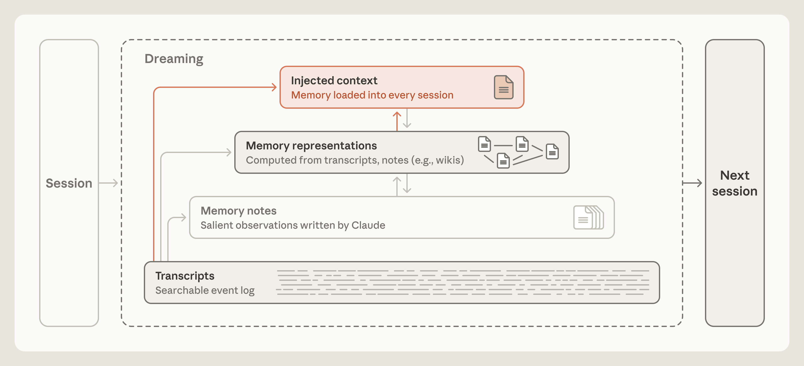

*图 13：Dreaming 可以向记忆层级的顶部写入内容。注入上下文会在每次会话中加载，而下方各层则由 Claude 在需要时读取或搜索。*

## Dreaming 可以让记忆围绕特定目标组织

Dreaming 还可以塑造记忆的增长方式。例如，[Claude Duet](https://support.claude.com/en/articles/17631495-get-started-with-claude-duet) 这样的助手，通常能从围绕其服务对象组织的记忆中受益；我们也可以调整 dreaming，使它围绕特定目标构建记忆。

指导记忆增长的指令会因任务而异，它们告诉 Claude 哪些信息真正重要。例如，LAB 基准中的一项任务模拟了一次公司收购，并提供一组合同。评分会检查法律简报是否正确描述了合同条款。

起初，我们只提供了构建 Wiki 的基本指令，没有告诉 Claude 这个 Wiki 要如何使用。这项任务高度依赖合同条款，但在构建 Wiki 时，多个智能体同时向一张共享的合同条款表写入内容（见图 14 左）。

*图 14：修改指令前后，进入 Wiki 的待评分合同事实数量。左：多个智能体写入同一个共享页面，57 项事实中保留了 41 项。右：每份合同由一个智能体负责，分别写入独立页面，并逐字引用条款，57 项事实全部保留。*

结果得到的 Wiki 缺失了关键事实。当我们为基于这个 Wiki 生成的简报评分时，Claude 只纳入了 57 项事实中的 41 项，也就是 72%。检查问题原因后，我们发现：共享表格对合同条款的概括质量不佳，有些条款甚至完全缺失，因为智能体相互覆盖了对方的工作。

合同条款是这个 Wiki 最重要的部分，但指令没有说明这一点。为了找到更好的指令，我们运行了一个循环：让 Claude 反思自己的失败，提出指令修改方案，再重建 Wiki。这个循环让 Claude 发现了忠实保留合同条款的重要性，并据此重写了 Wiki 构建指令。

每份合同都获得了自己的 Wiki 页面，由一个智能体单独编写，逐字引用条款，而不是将其概括到共享表格中。评估基于改进后 Wiki 生成的简报时，可以满足的评分标准从 72% 提升到了 100%。

## Dreaming 可以补上单次会话留下的缺口

Claude 写记忆笔记时，只能看到当前会话的上下文。Dreaming 则可以跨多个会话进行搜索，发现共同模式或纠正常见错误。

在为 LAB 基准构建 Wiki 时（例如图 14 所示的情况），Claude 有时会链接到尚未创建的页面。第二轮 dreaming 补上了许多这样的缺口。在一项任务中（见图 15），dreaming 发现 Wiki 中有九条链接指向一个不存在的页面，于是将它们重新指向同一份文档对应的已有页面。它还新增了三个页面，其中包括一个索引页，以完善 Wiki。

*图 15：第二轮 dreaming 前后的 Wiki。*

## 回望过去，面向未来

如何为智能体设计记忆系统，还有许多开放问题。其中一个问题是：Claude 应该在什么时候创建记忆？执行任务时，Claude 可以向记忆存储——例如文件夹、文件或数据库——写入内容，在信息产生的地方及时捕捉重要内容，让关键细节立即可供后续轮次或会话使用。但即时记录笔记，难免会分散 Claude 对主要任务的注意力。相比之下，dreaming 可以把记忆创建移到后台，不过其产出未必能立即被 Claude 访问。

另一个问题是：如何让记忆可靠地保持更新？Claude 可能作出错误预测，或者把从一开始就不正确的规则写入记忆。记忆也可能随着环境变化而失准，变得不再相关。Dreaming 是修正这些错误的一种方式（见图 8），但它需要消耗算力。要求 Claude 持续检查所有记忆，可能并不现实。更重要的做法，也许是让 dreaming 聚焦于容易变化的信息，或者仔细调整 dreaming 的频率，例如根据记忆被访问的频率来调整。

将执行记录搜索视为 Claude 记忆的基础，也是一种合理思路。把 Wiki 等表示形式与搜索结合起来，有时会很有效（见图 10）。但 Claude 需要消耗算力维护这些记忆表示，确保它们不会不断累积错误或幻觉。

尽管 Claude 对“什么值得记住”的判断已经有所提升，但没有任何模型能真正知道未来的轮次会发生什么。Dreaming 给了 Claude 一个回望过去的机会，让它利用算力组织记忆、纠正错误，并维护那些让未来会话更容易访问记忆的表示形式。随着 Claude 能力增强，记忆系统也将不断演进；对于如何设计 Claude 的记忆系统，我们仍有很多需要学习的地方。

关于如何开始使用，请参阅我们的 [dreaming 入门](https://platform.claude.com/cookbook/managed-agents-cma-dreaming-with-a-dynamic-workflow)和[知识 Wiki](https://github.com/anthropics/claude-quickstarts/tree/main/managed-agents/knowledge-wiki) Cookbook 示例教程。

## 作者与致谢

本文由 Lance Martin 撰写，Caitlin Love、Tom Chivers、Rebecca Hiscott、Jake Eaton 和 Blake Wilson 提供编辑指导。感谢 Barry Zhang、Theodora Chu、Daliang Li、Mahesh Murag、Jake Noble、Ravi Trivedi、Tina Vachovsky、Brad Abrams、Henry de Valence、Jeremy Fox、Matt Bell、Allen Li、Chris Gorgolewski、Eugene Yan、Artur Renault、Wei Zhang 和 Kevin Chen 提供有益的讨论与贡献，也感谢 David Hershey 对 Claude Plays Pokémon 的贡献。插图由 Monika Tuchowska 制作。

---

**原页相关文章**：[*Harness design for long-running application development*](https://www.anthropic.com/research/harness-design-long-running-apps)（《面向长时间运行的应用开发的运行框架设计》），Engineering，2026 年 3 月 24 日。原页另有“[查看更多](https://www.anthropic.com/search?topic=agents)”入口。
