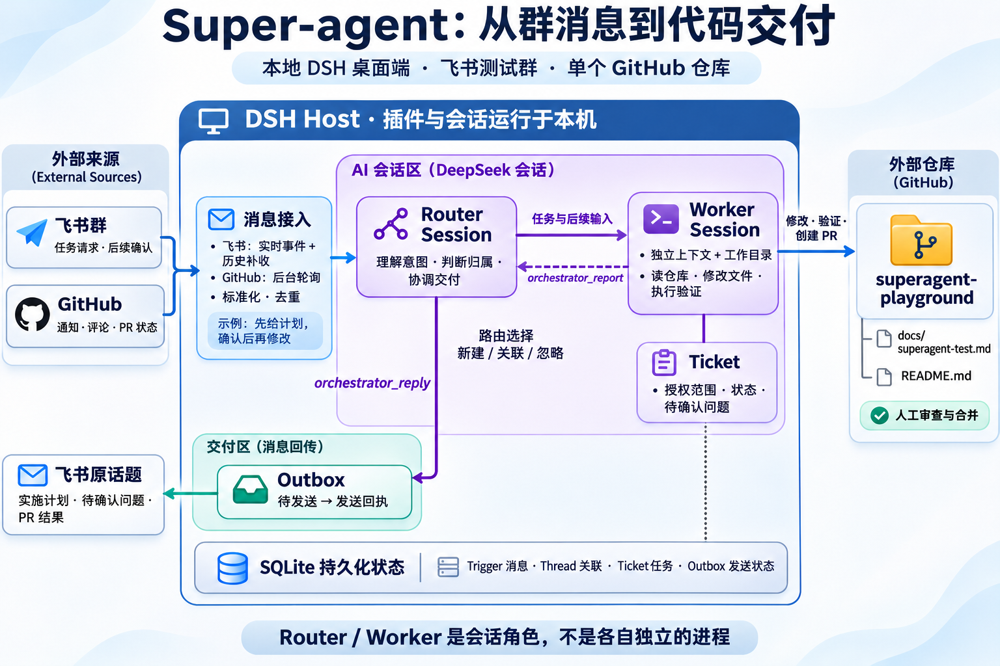
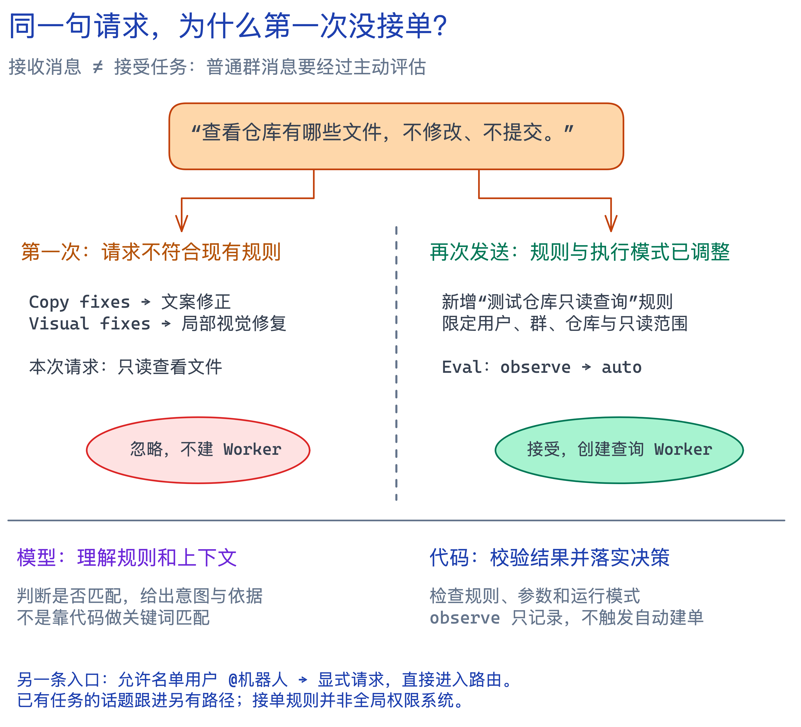
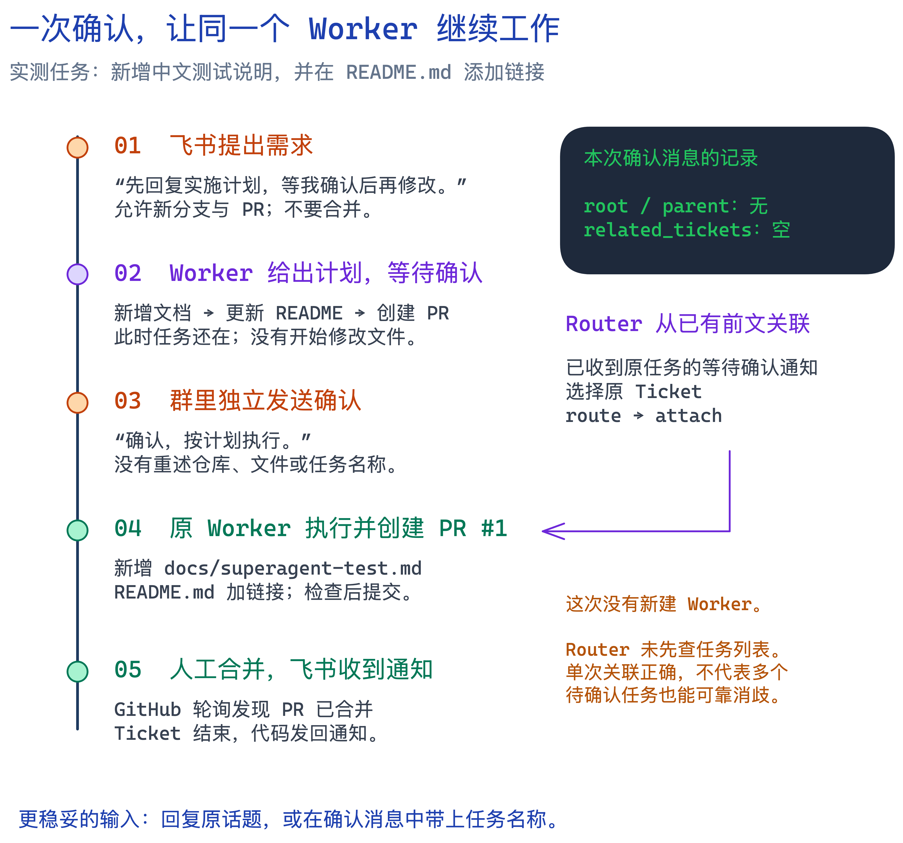
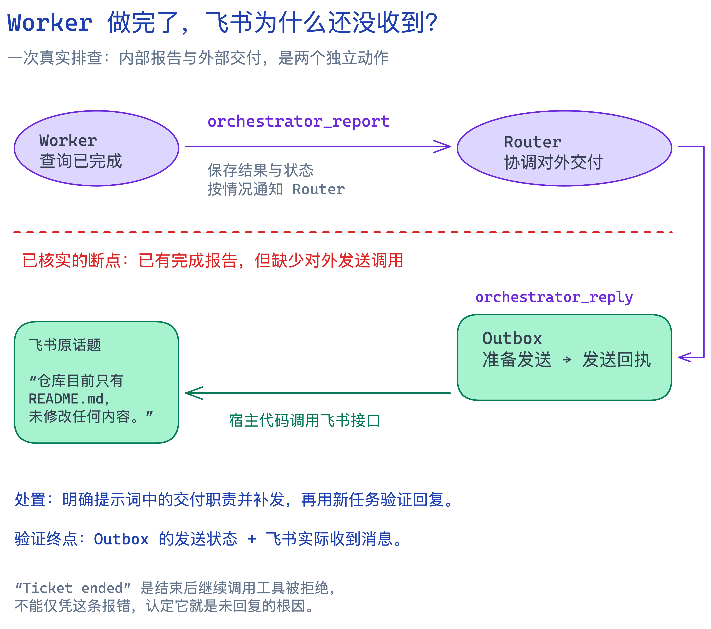
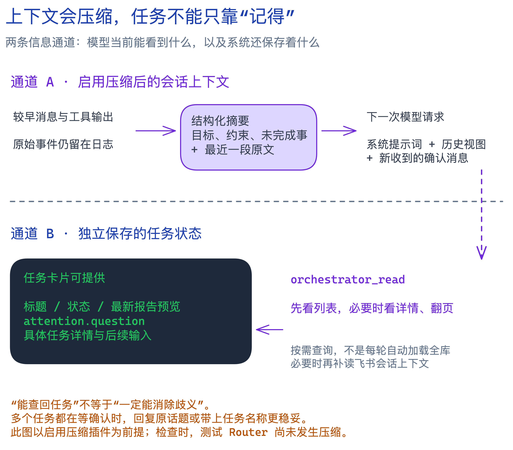

在飞书群里提出需求，让智能体先给计划；过一会儿回复“确认，按计划执行”，它继续修改仓库、验证并创建 PR。人工合并之后，原话题又收到一条“PR 已合并”的通知。

这次体验让我关注的，不只是模型能不能写代码，而是另外几个问题：群消息怎样变成任务？一句没有仓库名的“确认”，怎样找到之前的执行者？任务做完了，谁负责回复？程序退出以后，消息还会不会被处理？

[DeepSeek Super-agent prototype](https://github.com/deepseek-ai/dsh-superagent-prototype) 把这些环节接在了一起。它作为 DeepSeek Harness（下文简称 DSH）的插件运行，连接飞书、GitHub、模型会话和任务状态。本文先讲架构，再用我在桌面端完成的一次真实任务说明它如何工作。

> 实践日期为 **2026 年 11 月 11 日**。本文依据本地 Super-agent `8c32a9dc`、DSH `fcc0ad4621` 源码和桌面运行记录整理；源码版本与已安装桌面端构建不应视为完全相同。配置中的只读查询、开发接单规则和交付提示词是本次测试的定制内容。本文没有将单次测试成功视为可靠性评测，也不逐函数展开源码。

## 1. 架构：让消息成为可以持续推进的任务

普通编程助手通常从一个对话开始：人发出请求，助手使用工具，然后在当前窗口回答。Super-agent 接收的是持续到来的外部信息。它既要识别新工作，也要判断一条消息是不是已有工作的补充。

它的基本结构可以分成消息接入、任务协调、具体执行和持久化状态四部分。

*图 1：依据本次实践绘制的总体架构（imagegen，非产品截图），展示新请求经 Router 分配并回传结果的主路径。实线表示消息或工作流向，虚线表示内部报告，点线表示状态关联；实际投递由宿主落实。*

图中“本地运行”指 Host、插件和会话管理，不代表模型推理也在本机。“AI 会话区”表示 DSH Session；具体模型取决于配置。这张图没有展开两条旁路：已有任务的话题跟进可以直接送到 Worker，PR 合并通知则由代码生成并发送，后文会分别说明。

### Router：决定工作交给谁

Router 是一个长期存在的 DSH Session。它会收到新候选消息、Worker 汇报以及任务状态通知，判断是创建新任务、关联旧任务、停止工作，还是忽略。

它还负责把需要人工回答的问题、准备好的结果交付到原来的协作场景。Router 的职责偏向协调；具体读取仓库、实施修改和验证，交给 Worker。

### Worker：围绕一个任务执行

接受一个新任务后，宿主为它安排 Worker Session 和工作目录。Worker 获取原始请求、授权范围及后续输入，使用文件、终端、GitHub CLI 等工具完成工作。本次确认接续复用了原 Worker；这不意味着一个 Ticket 在所有恢复或重新调度场景中都永远只有一次执行记录。

这里的 Router 和 Worker 是**会话角色，不是每个角色各启动一个操作系统进程**。桌面端的 Host 加载插件、管理会话与后台循环；工具执行可以再创建子进程。不能从侧边栏里的三个会话，推断机器上有三个独立 Agent 服务。

### 数据库：任务不只存在于模型记忆里

几个对象有助于理解整套流程：

| 对象 | 保存什么 | 为什么需要 |
| --- | --- | --- |
| Trigger | 标准化后的消息、发送者、来源和时间 | 同一消息可以去重、追踪去向 |
| Thread | 话题、订阅它的任务及关联信息 | 后续回复可以送到已有任务 |
| Ticket | 任务范围、状态、执行记录、输入和报告 | 重启或上下文压缩后仍能找回工作状态 |
| Outbox | 对外发送的消息及发送状态 | 区分“准备回复”和“已经发送” |

这些数据保存在插件的 SQLite 数据库中。例如，`ticket` 表的 JSON 值包含任务输入和执行记录，Worker 的报告保存在 `assignments[].report`，待回答问题可记录在 `attention.question`。模型通过 `orchestrator_read` 读取精简卡片，必要时再读取详情；不需要每次把全部任务历史塞进提示词。

## 2. 消息接入：实时监听之外，还有补收

GitHub 和飞书采用了不同的接入方式。

**GitHub 使用轮询。** 当前测试配置是每轮查询结束后至少等待 60 秒；GitHub 要求更长间隔时，以更长间隔为准。轮询会检查通知、启用的仓库事件流、已有任务关联的 PR 和订阅话题。它是程序调用 API，不是每分钟让模型读一次 GitHub。

**飞书使用实时事件消费，同时补查历史。** 插件启动 `lark-cli event consume im.message.receive_v1 --as bot` 子进程，从输出中接收事件；后台还会定期查询配置群的历史消息，以及任务订阅的话题回复。

这里有两个容易混淆的“读取历史”：

| 行为 | 谁决定执行 | 目的 |
| --- | --- | --- |
| 历史补收 | 后台代码定时执行 | 找回实时连接可能漏掉的新消息 |
| 上下文读取 | 模型调用工具 | 理解“确认”“按刚才计划”等省略了信息的消息 |

补收使用持久化时间游标，并把查询边界向前重叠 5 秒，再通过消息 ID 去重。首次接入群时只建立当前游标，不会把群里所有旧聊天都当成新任务。

这也解释了一个运行行为：完全退出 DSH 后，插件不能继续执行；再次打开、来源仍启用且沿用原数据库时，会尝试补收上次游标之后的群消息。补收的消息仍要经过来源过滤、去重和任务归属判断，不是取回后全部执行。**源码没有给群历史补收加固定的 24 小时上限，也没有因为消息过夜就自动拒绝任务。** 实际取回范围仍受飞书权限和消息保留情况影响。另有 14 天窗口，用于清理不再追踪的旧话题，以及限制无活跃任务的订阅话题继续轮询；它不是所有群历史的回看上限。

在本次 macOS 桌面环境中，也要区分关闭主窗口与退出应用：对应桌面源码将主窗口关闭处理为隐藏，Host 继续运行；通过退出菜单或 `⌘Q` 完全退出，才会关闭 Host。电脑睡眠或断网时，自然不能保证持续接收和处理。

## 3. 接单：听到一条消息，不等于开始工作

我先用测试仓库做了几次只读查询。前后发送三条消息，最终只出现两个 Worker，原因不是漏消息，而是第一条被策略忽略。

当时开启的是官方默认的两条规则：`Copy fixes` 和 `Visual fixes`，分别面向文案修正和目标明确的局部视觉修复。“查看仓库有哪些文件”不符合它们。后来新增“测试仓库只读查询”规则，并将 Eval 从 `observe` 调整成 `auto`，再次发送才成功建单。

这里的 **Eval 是对候选消息的一次评估**，不是另一个模型进程。等待评估的消息保存在持久化话题记录里，由后台调度送入 Router 会话处理。第一条请求是在候选卡片上被直接判为忽略的，不是所有普通消息都必须完整执行一次规则评估。

**官方这两条规则默认是开启的。** 测试面板中后来显示关闭，是本次配置调整的结果，不是官方默认状态。

*图 2：同类请求在接单规则与运行模式调整前后的不同去向；图内请求为节选。*

### 规则由谁匹配？

接单规则的自然语言说明会进入 Router 系统提示词。模型理解消息与上下文，对开启的规则返回是否匹配、理由以及接单结论。

当模型通过评估工具接受一个推断请求时，代码会检查：规则 ID 是否有效、每条开启的规则是否都被评估、是否至少命中一条规则、是否提供了意图证据，以及当前模式是否允许自动执行。这些要求不能套用到显式请求或“候选卡片已足以忽略”的快捷路径上。

因此，这里有两层不同的判断：

- **模型判断语义**：这句话是否真的在要求做某件事，是否符合规则正文。
- **代码检查条件**：规则是否开启、参数是否合法、当前模式能否执行。

`observe` 模式下，即便模型认为应该接受，推断请求也只会记录“本来会接受”，不会因此创建执行任务。

### 为什么 @机器人又是另一条路径？

允许名单中的用户，在已接入场景中 @机器人，会被视为显式请求，走直接路由，不要求命中上述主动接单规则。普通群消息则可能作为推断候选进入 Eval。

所以，接单规则不是全局权限系统。“只读查询”写在接单规则里，不代表一个明确的 @修改请求也会被它强制拦截；其他发送者 @机器人，也不自动获得允许名单用户的身份。

为了后面的开发测试不必 @机器人，我又新增“测试仓库开发与上下文接续”规则：仅接受指定用户、指定群、指定测试仓库的明确任务，按实际授权修改、提交和创建 PR，不自动合并。这个限制范围属于本次测试配置。

## 4. 一次真实开发任务：先给计划，再等待确认

环境准备采用 DSH 桌面端、一个飞书测试群和一个私有 GitHub 测试仓库。GitHub 使用我的现有账号；因为来源会过滤该账号自己的相关消息，任务从飞书发起，不把“同账号在 GitHub 自己 @自己”作为测试入口。

我在群里发送了下面的任务，没有 @机器人：

> 请在 shenlihust/superagent-playground 仓库新增 docs/superagent-test.md，写一份中文测试说明，包含项目用途、测试步骤、预期结果三个部分，并在 README.md 中添加链接。允许修改文件、提交到新分支并创建 PR，不要合并。开始前先回复你的实施计划，等我确认后再修改。

它包含三个层次：要产出什么、允许进行哪些仓库操作，以及什么时候才能开始修改。

*图 3：实测任务时间线与确认关联依据。原 Worker 接收确认后继续执行；合并通知由代码生成。*

### 从消息到 Worker

Router 接受请求后，宿主创建 Ticket，准备任务工作目录，建立 Worker Session，将原始请求和任务范围投递到会话 Inbox。DSH 再把输入纳入模型上下文，驱动 Worker 使用工具。

Worker 核对仓库状态，提出计划，但没有立即改文件。它将等待确认的问题报告给 Router，Router 再把问题发送到原飞书消息的话题下：

> 计划：1）新增 docs/superagent-test.md，写项目用途、测试步骤、预期结果三部分；2）在 README.md 添加链接；3）提交到任务新分支并创建 PR，不合并。确认前不改文件。可以按此执行吗？

此时任务仍然存在，只是等待人的输入。模型某一轮结束，不等于整个任务结束。

### 确认后执行，PR 留给人工审查

随后我发送：

> 确认，按计划执行。

原 Worker 继续工作，新增测试文档、更新 README 链接，完成检查后提交到任务分支，创建 PR #1。执行报告记录了标题结构检查、链接目标存在、`git diff --check`、远端内容核对，以及 PR 仅包含预期两个文件。当时 `gh pr checks` 返回没有检查项，这些验证不等于“CI 全绿”。

飞书话题收到“已按计划完成……待你审阅，未合并”。这次验证的是**原任务在等待确认后继续执行**；第二条消息没有新增需求。

## 5. 一句“确认”，究竟是谁关联到原任务的？

这次最有意思的细节藏在实际路由记录里。确认消息没有记录 `root_id` 或 `parent_id`，内部话题标识也与原始任务不同。程序交给 Router 的候选卡片中，`related_tickets` 是空的。

也就是说，这次不是依靠“原话题订阅关系”直接送到 Worker。

Router 此前已经收到 Worker 的等待人工回答通知，知道哪个任务刚提出了什么计划。确认到达后，它调用 `orchestrator_route`，选择 `kind="attach"`，目标是原来的文档任务，并附上“用户确认按计划执行”的路由说明。

宿主将消息送入原 Worker Session，数据库中也记录它投递给了原执行 assignment，没有新建 Worker。Worker 接收到的是确认原文和路由说明，同时仍有自己之前的任务与计划上下文。

### 话题关联与语义关联，可靠性不同

如果是在原话题里回复，程序可以利用订阅关系找到任务，再由 Worker 判断新消息是否属于当前工作；超出范围时，Worker 可以把消息交回重新评估。

独立发在群里的“确认”则需要推断。如果多个任务同时等待确认，仅凭这句话就可能产生歧义。这次成功发生在时间相近、等待确认对象明确的场景，不能推广成“它总能理解我指的是哪个任务”。

官方提示词对此其实有要求：相关任务为空或不合适时，先用 `orchestrator_read` 查未结束与已结束任务；上下文压缩后检查任务摘要；不能只因主题相似就关联。在主动评估中，也要求先补读必要的话题上下文，再判断一个简短回复是否只是普通附和。

**这次 Router 没有先查任务列表，直接完成了 attach。** 关联结果正确，但工具轨迹没有执行上述查询要求。这恰好说明：提示词规定了行为，不等于程序验证了每一步都被遵守。

## 6. 内部汇报与外部交付，是两件事

*图 4：第一次只读任务的交付断点。内部报告不等于已经发送，交付要验证发送回执与来源会话。*

前面的只读测试还遇到过一个问题：Worker 已经完成查询，飞书却迟迟没有结果。

当时的报告确实写了“已用 reply_to_trigger_id 回复原飞书会话”，但发送轨迹并不支持这个完成声明，Router 随后也没有调用真正的发送工具。**能确定的断点是缺少对外发送；报告中的误导性表述可能影响了 Router 判断，但无法仅凭日志证明模型漏发的全部原因。** 后来明确了交付职责的提示词配置，并补发结果；后续只读和开发任务验证了自动回复链路。这是一次配置层面的纠偏，不是已经修复并全面验证了官方源码中的某个确定性缺陷。

三个名字相似的工具，职责并不相同：

| 工具 | 实际作用 |
| --- | --- |
| `orchestrator_ack` | 发送收到请求的简短确认 |
| `orchestrator_report` | Worker 记录状态和结果，按情况通知 Router |
| `orchestrator_reply` | Router 请求向来源发送回答、结果或人工问题 |

工具调用之后还要看 Outbox 的发送状态。模型说“已发送”，不能替代发送回执。第一次排查中出现的 `Ticket ended; new work needs a new authorized ticket` 是任务结束后继续调用工具被守卫拒绝，不能把它直接当成未回复飞书的根因。

## 7. PR 合并后的收尾，反而不需要模型判断

我审查并手动合并 PR #1 后，飞书原话题又收到：

> PR #1 已合并。

这是一条固定模板通知。GitHub 来源发现绑定 PR 的状态已经变成 merged，任务系统更新状态，程序生成通知并通过 Outbox 发送到原消息地址。通知使用稳定的幂等标识，避免重复发送。

这里还有一个状态区别：**Worker 的 `ready` 报告不必然结束 Ticket。** 无待跟踪对象的只读任务可以在报告完成时结束；本次开发任务绑定了 PR，报告结果就绪后仍继续跟踪，直到 PR 合并才记录终态。因此，提交 PR、对人交付结果和任务结束是不同的节点。

这次记录中的合并时间是 15:45:27，本地任务更新时间是 15:47:18，与轮询发现状态变化的机制一致。这是本次运行的时间差，不是系统承诺的通知延迟。

**“不要自动合并”限制的是智能体主动操作仓库，不影响系统跟踪人工合并的结果。** 同时，它在本次环境里主要写在交付提示词和接单规则中，不是 GitHub 权限层面的硬禁止，也没有配置专门拦截所有合并命令。

## 8. 长期 Router：压缩历史，还要找得回任务

Router 会持续接收各种消息，自然会遇到上下文越来越长的问题。更新后的 DSH 源码提供了**可选的压缩能力**：加载相应插件后，达到上下文压力阈值时，可先调用工具结果裁剪服务，再重新测量；仍需压缩时，由模型把较早历史整理成结构化摘要，并按保留策略留下最近的一段原文。不能仅凭使用了 DSH 就断言任意部署都开启了这套机制。

*图 5：上下文摘要和持久化任务记录是两条信息通道。上半部以启用压缩插件为前提；此图说明源码机制，不代表本次已触发压缩。*

摘要模板要求保留用户意图、关键文件、错误与修复、未完成任务、当前工作、下一步、约束与开放问题。旧摘要会与新信息合并，原始事件仍保留在日志中，但后续模型请求使用替换后的上下文视图。

这是通用摘要机制，没有专门检查“每个待确认工单的 ID 和问题是否全部保留”。最近历史有原文保障，旧信息则需要经过摘要模型的选择。

好在任务状态并不只存在于摘要里。Router 可以调用 `orchestrator_read`，传入 `{"resource":"tickets"}`，取得包含任务标题、状态、最新报告预览和 `attention.question` 的卡片，再查询具体任务。列表是分页返回，也不是只返回待确认任务，必要时还要翻页。

这些查询能力为压缩后的上下文恢复提供了依据，但“数据还在”不保证模型每次都会查询，也不保证一句脱离话题的“确认”只有一个解释。

## 9. 哪些交给模型，哪些由程序保证？

实践之后，我觉得这张分工表比“多智能体”这个词更能解释系统的行为。

| 事情 | 主要机制 | 边界 |
| --- | --- | --- |
| 接收指定群与仓库的消息 | 来源配置与代码过滤 | 接收不等于接受任务 |
| 识别是否符合接单规则 | 模型理解规则正文，代码校验结果 | 结构合法不代表语义判断一定正确 |
| 同一消息不重复建单 | 消息 ID 与接单记录去重 | 重新发送相同文字，是另一条消息 |
| 将话题消息送给已有任务 | 持久化订阅关系 | Worker 仍要判断内容是否相关 |
| 独立确认关联旧任务 | Router 上下文、工具查询与判断 | 查询要求目前主要靠提示词落实 |
| 任务结束后限制继续调用 | 工具守卫检查 Ticket 状态 | 是实际代码拦截，不只是文字提醒 |
| 等待确认、不要合并 | 本次任务指令与提示词 | 不能等同于账号权限被收紧 |
| PR 合并后发送通知 | 状态轮询、固定模板与 Outbox | 不必再次调用模型生成回复 |

这不是将全部流程交给一个模型自由发挥。程序维护身份、任务状态、输入归属、去重与投递；模型在这些结构之上理解意图、选择工具并执行工作。但也不能反过来认为，有了状态机就把所有自然语言约束都变成了硬权限。

## 10. 从单仓库试验走向实际项目

本文检查的原型版本中，GitHub 配置是单个仓库，不提供添加多个仓库的界面；内部部分标识也建立在这个前提上，例如用 `github:1` 表示当前仓库的 PR 或 Issue 线程。

公司往往有多个项目，一个项目也可能横跨前后端、SDK 和基础设施仓库。这时还需要在任务路由之前回答：**请求属于哪个项目，以及允许在哪些仓库行动？**

一种扩展方向是每个项目部署独立实例，隔离状态、权限和工作目录；另一种是增加项目路由，将消息送到对应项目的 Router。跨仓库任务还涉及多个 PR 的依赖、验证与交付。它们不是给输入框增加一个“添加仓库”按钮就能解决的，也不是本次已经验证的能力。

这次实践跑通了从群消息到 PR、再到人工合并反馈的完整过程。对我而言，最有价值的认识是：一个可以持续工作的 Agent，除了模型和工具，还需要消息身份、持久化任务、明确的交付职责，以及可恢复的上下文。模型负责理解和执行，外围系统决定这份工作能否被持续、可追踪地推进。

## 延伸阅读

- [DeepSeek Super-agent prototype 官方仓库](https://github.com/deepseek-ai/dsh-superagent-prototype)
- [Router 调度提示词：任务关联、压缩后检查摘要与交付](https://github.com/deepseek-ai/dsh-superagent-prototype/blob/8c32a9dc5d72c033816c6a8110b37f40cf94fba4/prompts/dispatch.md)
- [主动评估提示词：如何理解短回复与话题上下文](https://github.com/deepseek-ai/dsh-superagent-prototype/blob/8c32a9dc5d72c033816c6a8110b37f40cf94fba4/prompts/admission.md)
- [消息资源与任务查询接口](https://github.com/deepseek-ai/dsh-superagent-prototype/blob/8c32a9dc5d72c033816c6a8110b37f40cf94fba4/src/app/resources.ts)
- [飞书实时消费与历史补收](https://github.com/deepseek-ai/dsh-superagent-prototype/blob/8c32a9dc5d72c033816c6a8110b37f40cf94fba4/src/sources/feishu-loops.ts)
- [GitHub PR 绑定与终态通知](https://github.com/deepseek-ai/dsh-superagent-prototype/blob/8c32a9dc5d72c033816c6a8110b37f40cf94fba4/src/sources/github-pull.ts)
- [DSH 压缩能力：插件、工具结果裁剪与摘要替换](https://github.com/deepseek-ai/deepseek-harness/blob/fcc0ad4621/docs/subsystems/compaction.zh.md)
