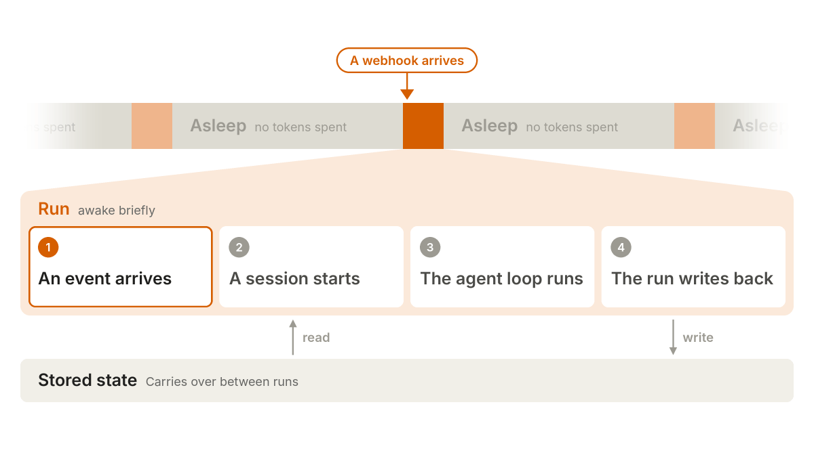
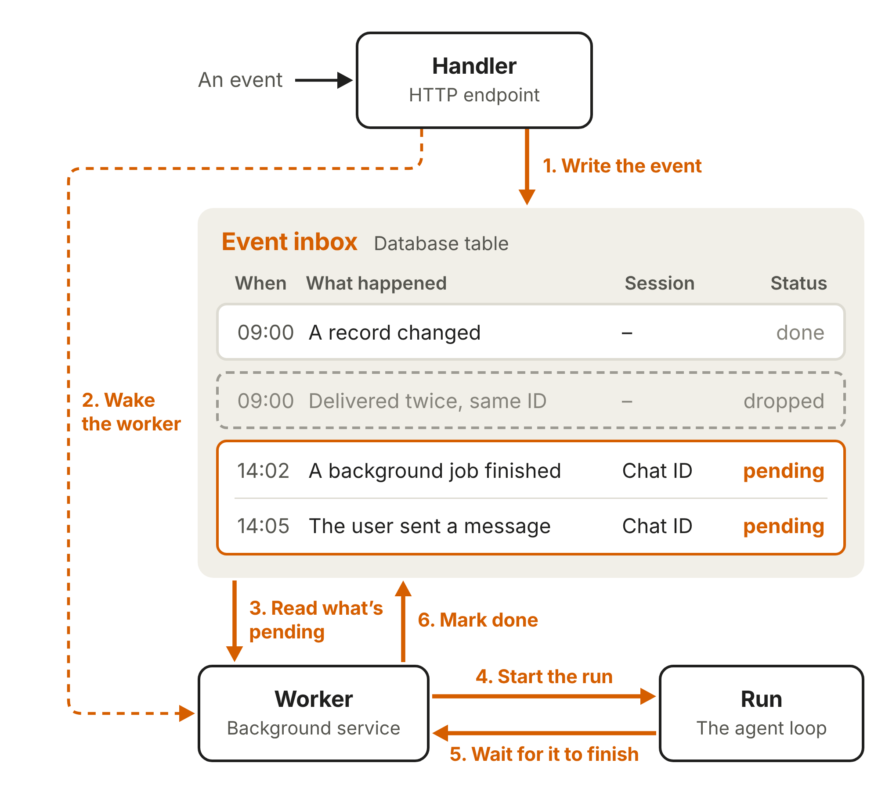
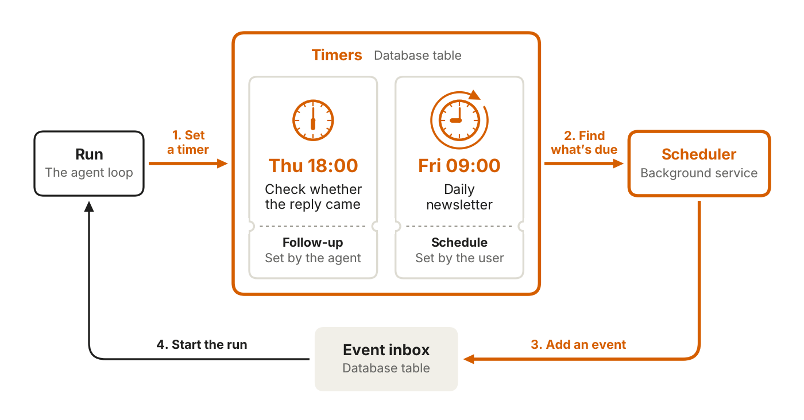
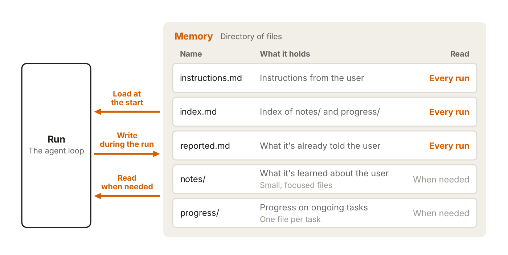
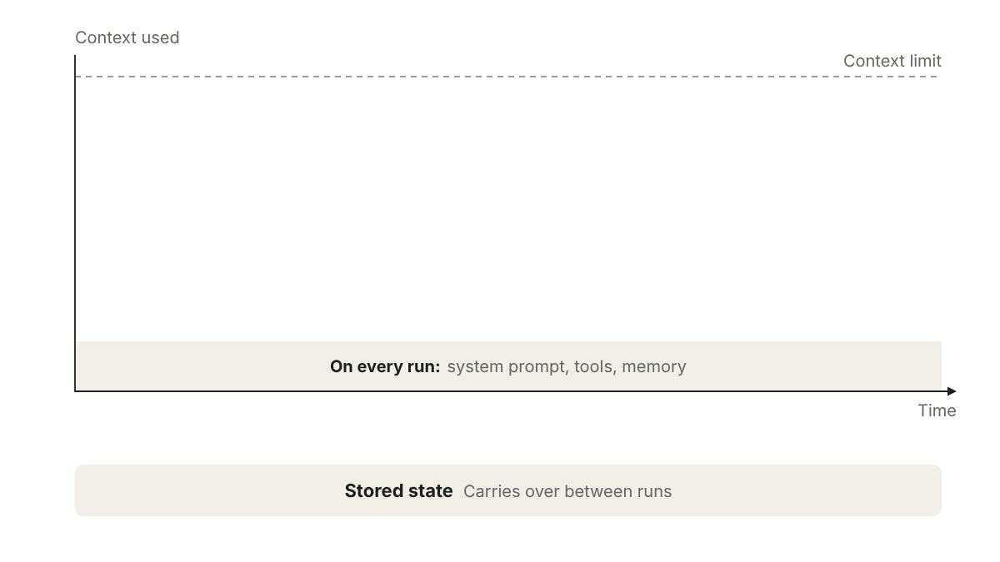
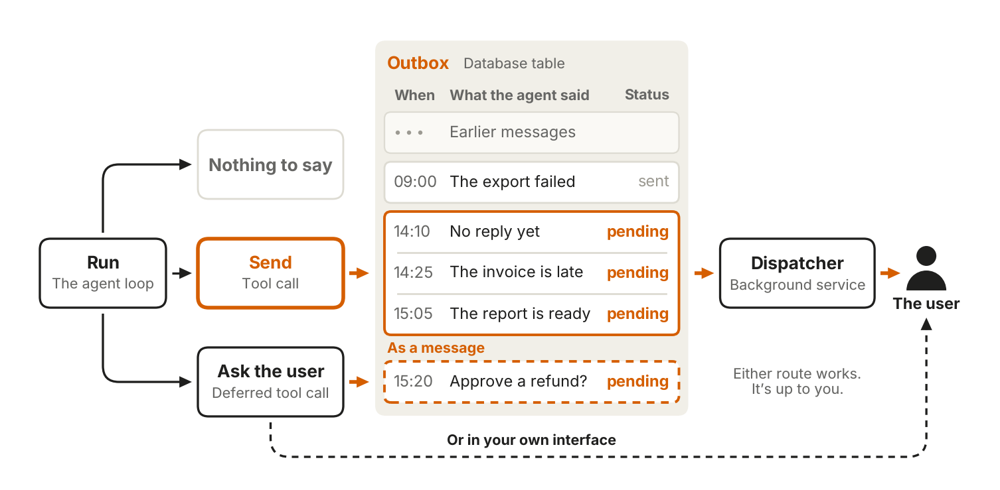
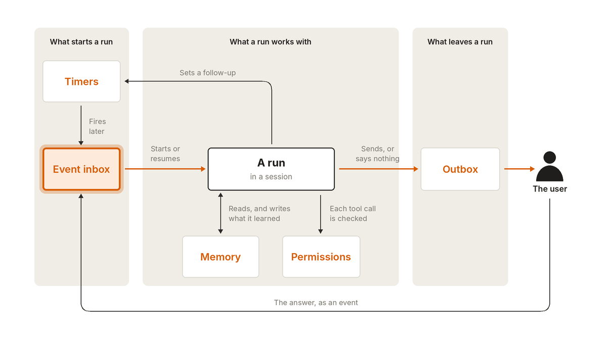

> **原文**：[Building always-on agents](https://claude.com/resources/articles/building-always-on-agents) 
> **作者**：William Hu 
> **原文发布日期**：2026 年 11 月 13 日 
> **原文分类 / 产品**：最佳实践 / Claude Platform 
> **原文预计阅读时间**：14 分钟 
> **译文说明**：本文根据用户提供的原文全文翻译，并对照原网页保留正文引用链接及全部 7 张插图（含 3 张 GIF 动图）。Always-on agents 译为“常驻智能体”，run 译为“一次运行”，session 译为“会话”。图片保留英文原图，替代文本及说明译为中文。文中的“我们”指原作者团队；模型名称、数据和相对时间沿用原文发表时的语境。原文及图片版权归原作者及相应权利人所有，译文仅供学习交流。

常驻智能体可以持续运行，自主决定如何以及何时跨多个会话采取行动。本文将介绍它们的核心基础组件，以及这些组件如何配合工作。

过去几个月，我们看到常驻智能体再次兴起。

常驻智能体具有状态，也具有主动性：它们能够跨会话管理上下文，并在没有直接监督的情况下采取行动。在底层，它们运行的[核心循环](https://www.anthropic.com/research/building-effective-agents)与其他智能体相同。差别在于外围架构：构成这一架构的基础组件决定了智能体何时被唤醒、哪些信息会在不同运行之间保留，以及工作成果如何送达用户。

这股热潮主要得益于近期模型能力的进步，这些进步让运行常驻智能体变得更加可行。首先，最新模型的判断力更强：它们能更可靠地理解用户意图，并判断何时需要向用户确认或沟通。其次，智能的成本正在下降，其中长程任务受益最大。例如，在[一项长程编程基准测试](https://platform.claude.com/docs/en/about-claude/models/optimizing-for-cost-and-intelligence)中，Opus 5.5 每解决一项任务的成本比 Opus 5 低 78%；而在典型工作负载中，降幅为 40%。

客户开始询问我们，如何将这类体验集成到自己的产品中。有些公司希望让现有智能体更主动，另一些则打算从零开始构建。

本文将拆解常驻智能体背后的基础组件，并介绍它们如何配合工作。

## 常驻智能体背后的循环

常驻智能体其实并不是“一直在线运行”。这只是对用户体验的描述。

实际上，智能体大部分时间都在休眠，只会间歇性地醒来工作。每一段工作过程称为一次运行（run）：智能体接收一个事件、完成任务，然后保存这次工作中发生的事情。运行发生在一个会话（session）之中，会话就是消息和工具调用的记录。运行结束后，智能体重新进入休眠，如此无限循环。

*常驻智能体的时间线：休眠、被事件唤醒、执行工作、保存状态，再次休眠。*

## 核心基础组件

常驻智能体的外围架构包含五个核心基础组件：事件收件箱、定时器、记忆、权限和发件箱。下面逐一介绍。

### 事件收件箱

大多数 AI 智能体只有在用户发送消息时才运行。常驻智能体则可以由多种事件触发，包括 webhook、计划任务和后台作业。

一种很容易想到的做法，是让每个事件源直接调用智能体，但这会带来几种故障情况。例如，两个同时到达的事件可能启动相互竞争的运行；一次崩溃也可能导致某个事件彻底丢失。

这就是事件收件箱发挥作用的地方。各个事件源不再直接调用智能体，而是将事件发送到收件箱，再由工作进程（worker）从中取出。

最简单的版本由三个部分组成：

- 一个持久化的事件列表，通常是一张数据库表；
- 一个将事件写入列表的处理器（handler），通常是一个 HTTP 端点；
- 一个从列表读取事件的工作进程，通常是一个后台服务。

收件箱应跟踪每个事件的状态，并可依据来源提供的唯一标识符对事件去重。关系型数据库很适合用作收件箱，每个事件都作为新的一行追加进去。我们建议先为每位用户设置一个收件箱；如果需要更高的并行度，可以进一步拆分。

*事件收件箱：处理器负责写入事件，工作进程负责读取、执行和标记完成。*

新事件到达时，处理器将事件写入收件箱，并唤醒工作进程。工作进程读取待处理的事件，启动一次运行。对于延续此前工作的事件，例如用户的回复，会恢复已有会话；其余事件则开启新会话。

接下来，工作进程将事件交给智能体循环，等待运行结束，再将对应事件标记为完成。实现细节可能比较棘手，以下是几项最佳实践：

- **处理器应迅速确认收到事件。** 某些来源（例如 webhook 提供方）会将响应过慢视为失败。处理器仍可执行轻量检查，但更深入的验证，例如检查提示注入，应放在运行期间完成。
- **收件箱应作为权威数据源。** 工作进程被唤醒后，应先从收件箱拉取最新事件。这样，即使工作进程在运行中途终止，新的工作进程仍可取出同一事件并重试。
- **一个收件箱在同一时刻只能有一个活跃工作进程。** 这可以防止两个运行重复工作，或相互覆盖。当新事件在运行中途到达时，可以留到下一次运行处理、并入当前运行，或中断后重新启动。
- **工作进程应批量处理待处理事件。** 例如，用户连续发送多条消息时，工作进程可以将它们合并到一次运行中，让智能体只需回复一次。

### 定时器

定时器与事件收件箱配合，让常驻智能体能够主动行动。定时器通常分为两类：后续跟进（follow-up）和周期计划（schedule）。后续跟进是智能体为自己设置的一个到期时间，例如届时检查是否收到回复。周期计划则是按已知频率重复执行的任务，例如每日简报。

定时器保存在独立的持久化存储中，通常是另一张数据库表，与收件箱分开。收件箱应只保存已经可以处理的事件。后续跟进和周期计划可以使用相似的数据结构，但周期计划还需要记录重复执行规则。

*定时器：调度器将到期项转化为收件箱事件，再启动下一次运行。*

定时器本身不会直接发起运行。调度器（scheduler，通常是一个后台服务）会按固定间隔轮询存储，触发所有到期项。每次轮询时，调度器会：

1. 扫描存储，找出已到期的定时器。
2. 根据类别更新各个定时器：后续跟进应标记为完成；周期计划则将到期时间更新为下一次执行时间。
3. 向收件箱添加事件，并唤醒工作进程。

调度器既可以自行实现为一个服务，也可以使用持久化执行引擎。

### 记忆

常驻智能体的工作横跨许多彼此分离的运行，需要依靠记忆维持连续性。

与事件收件箱和定时器类似，记忆也应拥有独立的存储。在我们的产品中，例如 Claude Code 的[自动记忆](https://code.claude.com/docs/en/memory)和 Messages API 的[记忆工具](https://platform.claude.com/docs/en/agents-and-tools/tool-use/memory-tool)，它被实现为一个文件目录。对于常驻智能体，这些目录应映射到持久化存储，通常是数据库或对象存储。这样，记忆就能在工作进程结束后继续存在。

一个经验法则是：记忆只应保存智能体无法再次查询到的信息。如果某项信息已存在于其他系统中，例如问题跟踪系统，应保存指向它的引用。下面是常驻智能体应保存的几类记忆：

- **用户指令：** 用户对智能体行为提出的任何指令，都应保存在专门的文件中，并在每次运行开始时加载。用户不会一直在旁指导，因此这些指令必须在不同运行之间保留。
- **用户笔记：** 智能体应保存它了解到的用户信息，例如用户的角色、偏好或提出的纠正。可以先使用一个文件，随着笔记增多再拆成多个小文件。后一种情况下，每次运行开始时只加载索引；需要更多细节时，智能体再将具体文件读入上下文。
- **历史消息：** 智能体应记录已经告诉用户哪些内容，避免重复。可以将这些内容存入一个独立文件，每次运行开始时加载；也可以由工作进程加载智能体最近与用户交流的几条消息。
- **任务进度：** 对每项正在进行的任务，智能体都应维护一份进度文件，记录已经完成的工作和剩余事项。任何新的运行都可以读取这份文件，从上次中断的地方继续。与用户笔记类似，每次运行开始时只加载索引，需要更多细节时再将具体文件读入上下文。

下图展示了一种配置示例。

*记忆目录示例：每次运行加载指令、索引和已报告内容，按需读取用户笔记与任务进度。*

以上介绍的都是在运行期间保存的记忆。还可以加入 dreaming（做梦，即后台记忆整理），通过回顾过去的会话来整理记忆。Dreaming 可以替换过时条目，也可以发现只有跨多次运行才会显现的模式。如果希望进一步了解，我们的[智能体记忆文章](https://www.anthropic.com/research/components-of-agent-memory)对此有更详细的介绍。

#### 上下文窗口内部

在开展任何工作之前，智能体会加载系统提示词、工具定义和记忆文件。每次运行都包含这部分初始上下文“开销”，因此我们建议保持其精简，并使用[提示词缓存](https://platform.claude.com/docs/en/build-with-claude/prompt-caching)降低成本。

新会话开始时，只有这部分上下文开销，以及触发此次运行的事件。已有会话则会恢复此前运行中的消息和工具调用。

如果会话变得过长，可以[压缩较早的消息](https://platform.claude.com/docs/en/build-with-claude/compaction)，也可以开启新会话。这两种方式都会丢失细节，因此，任何需要持久保留的信息，都应在工作过程中及时写入记忆。

*上下文窗口：固定的初始开销与不断增长的会话记录共同占用上下文，压缩可缩减较早的记录。*

### 权限

权限是常驻智能体风险最大的部分。运行持有用户的访问权限，而且按设计就是在无人看管的情况下执行。对于每次工具调用，智能体都需要判断：自行继续、阻止执行，还是等待批准。

权限相关组件与其他智能体使用的相同：

- **凭据存储：** 常驻智能体往往需要用户的敏感凭据，例如密码或访问令牌，才能发挥作用。[推荐模式](https://code.claude.com/docs/en/agent-sdk/secure-deployment#credential-management)是在智能体环境之外设置代理，由代理为出站请求添加凭据。智能体发送不含凭据的请求，代理注入真实凭据后再转发。
- **自动模式：** 常驻智能体应能在无需用户持续输入的情况下工作。我们已通过 Claude Code 的[自动模式](https://www.anthropic.com/research/claude-code-auto-mode)解决过这一问题的一种情形。自动模式使用分类器审查风险较高的操作，阻止被识别为危险的操作，让 Claude 寻找更安全的方案。不过，最重要的决定仍然需要用户审核。
- **延后执行的工具调用：** 在 Claude Code 中，[钩子可以延后执行工具调用](https://code.claude.com/docs/en/hooks#defer-a-tool-call-for-later)，等待用户提供更多输入。同样的模式也适用于常驻智能体，因为它们在执行某些操作前可能需要澄清或批准。工具调用被延后时，本次运行结束，会话则保存在调用尚未完成的状态。请求会展示给用户，例如通过使用 [MCP Apps](https://modelcontextprotocol.io/extensions/apps/overview) 构建的交互卡片；用户的回答以事件形式回到收件箱。

该事件会启动一次新的运行，带着用户输入恢复已保存的会话。在延后的调用等待回复期间，工作进程仍可处理其他事件，因此智能体不会被阻塞。

### 发件箱

大多数 AI 智能体会在生成回复的同时，以流式方式将其发送给用户，让用户可以跟随 Claude 思考问题、调用工具并撰写回答的过程。

常驻智能体则主要在后台工作。用户收到的是结果和少量细节，而不是完整的逐步过程。

*发件箱：保存待发消息，由分发器决定发送哪些内容并交付给用户。*

一次运行可以通过以下三种方式之一结束：

- 智能体向发件箱发送一条消息；
- 智能体判断无需发送任何内容；
- 智能体通过延后执行的工具调用，请求许可或更多输入。

对于大多数常驻智能体，一个直接将消息发送给用户的“发送”工具就足够了。只有当你希望控制智能体发送消息的节奏，或让它能够从错误中恢复时，才需要正式引入发件箱。

与事件收件箱类似，发件箱是一张独立的待发送消息表。此外还有一个分发器（dispatcher），通常是一个后台服务，对应于收件箱一侧的工作进程。分发器读取待发消息，决定哪些需要投递，再将其发送给用户。延后执行的工具调用所产生的请求，既可以通过发件箱发送，也可以直接显示在界面中。

除了投递，还必须调节智能体发送消息的数量。消息太多会造成干扰，太少则可能漏掉用户需要知道的事情。我们建议构建评估，找到适当的平衡。在实践中，最好让智能体一开始保持安静，再逐渐赢得用户更多的注意力。

## 各个组件如何配合

下面展示这五个基础组件如何配合工作：

*完整循环：事件触发运行，运行读取和更新记忆、在权限范围内采取行动，再通过发件箱与用户交互。*

每次运行都从收件箱中的一个事件开始，无论它来自用户消息、webhook 还是定时器。工作进程取出事件后，便启动一次运行，在新会话或已有会话中唤醒智能体。智能体读取记忆，了解基本情况，在权限范围内采取行动，再将新了解到的信息写入记忆。运行完成后，智能体向发件箱写入一条记录，由分发器将消息投递给用户。

这些步骤共同构成一个循环。一次运行可以设置定时器，在稍后再次唤醒智能体；用户回复消息后，回答又会作为事件回到收件箱。每次运行都很短暂，但这个循环可以无限持续，这就是智能体让人感觉始终在线的原因。

## 致谢

本文由 William Hu 撰写。特别感谢 Rodrigo Olivares 和 Michael Segner 的贡献。
